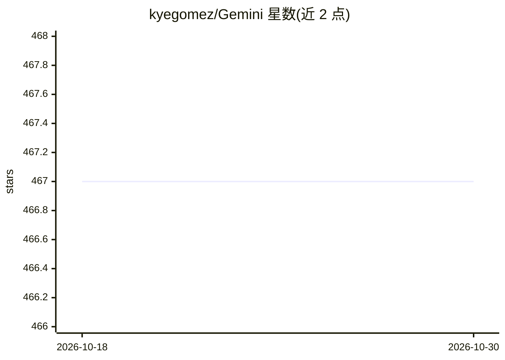

# kyegomez/Gemini

⭐ 467 · Python · MIT · 推送 2026-10-13 · [GitHub](https://github.com/kyegomez/Gemini) · [官网](https://discord.gg/GYbXvDGevY) · 个人维护

**Google Gemini 模型的开源复现尝试（PyTorch）**

基于 PyTorch 的 Gemini 多模态模型架构实现：将文本、图像、音频等输入统一 token 化后送入 transformer，采用 Fuyu 式架构（图像 embedding 直接输入而非 ViT 编码器），支持分组查询注意力/flash attention、RoPE/ALiBi 等位置编码与 kv cache，另含 Ring Attention 的 LongGemini 变体和复用 LLAMA 分词器的 SentencePiece 多模态 tokenizer。README 以 Google Gemini 报告为参照列出待办：视频处理、prompting 技巧与训练模型尚未完成，属于进行中的社区复现项目。

## 筛选速览

| 维度 | 判定 | 备注 |
|---|---|---|
| AI 角色 | `ai-native` | 本体是模型或模型工具 |
| 许可风险 | `permissive` | MIT |
| 部署形态 | `library` | 以包/库形式分发 |
| 模型依赖 | — | README 未给出锁定关系 |
| 硬件要求 | — | 无带数字的原话,不猜 |
| 安装摩擦 | `low` | 无编译、无系统依赖或容器化 |
| 成熟度 | `idea` | |

## 能力要点

- 文本/图像/音频统一 token 化输入 transformer 的多模态实现
- LongGemini 变体采用 Ring Attention（暂无多模态处理）
- 基于 LLAMA 同款 SentencePiece tokenizer 并加入多模态特殊 token
- 支持分组查询注意力、flash attention、RoPE/ALiBi/xPos、kv cache

## 适用场景

- 研究多模态 transformer 架构的参考实现
- 在本地训练或实验自定义多模态模型
- 跟踪 Gemini 技术报告要点的社区复现进度

## 场景标签

`多模态` `模型训练` · 领域:感知与多模态

## 证据(README 行号)

> L11: The input sequences for Gemini consist of texts, audio, images, and videos. These inputs are transformed into token
> L35: ### Full Multi-Modal Gemini

## 星数曲线

2026-10-18 467 → 2026-10-30 467（+0）

---
*卡片 v1 · prompt 1.4 · 生成 2026-10-22 · 置信度 high · 依据 README sha `bc09b960516c` · [字段定义](../../DATASET.md)*
