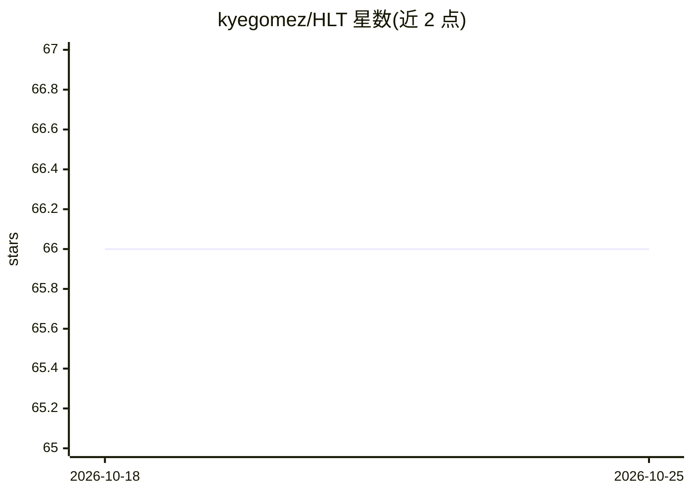

# kyegomez/HLT

⭐ 66 · Python · MIT · 推送 2026-10-10 · [GitHub](https://github.com/kyegomez/HLT) · [官网](https://discord.gg/GYbXvDGevY) · 个人维护

**人形机器人运动 Transformer 的 PyTorch 实现**

论文《Real-World Humanoid Locomotion with Reinforcement Learning》中机器人 Transformer 的 PyTorch 实现：包含状态策略模型（MLP/FFN）与一个接收观测和动作 token、输出下一动作序列的 Transformer 模型。以 Python 库（pip 安装）形式提供给机器人学与强化学习研究者和开发者使用。README 仅含安装与基础用法示例，训练流程与数据细节未在可见范围内展示。

## 筛选速览

| 维度 | 判定 | 备注 |
|---|---|---|
| AI 角色 | `ai-native` | 本体是模型或模型工具 |
| 许可风险 | `permissive` | MIT |
| 部署形态 | `library` | 以包/库形式分发 |
| 模型依赖 | — | README 未给出锁定关系 |
| 硬件要求 | — | 无带数字的原话,不猜 |
| 安装摩擦 | `low` | 无编译、无系统依赖或容器化 |
| 成熟度 | — | 结构信号不足 |

## 能力要点

- 实现论文中的 HLT Transformer 结构
- 同时提供 MLP/FFN 状态策略模型
- 输入观测与动作 token，输出下一动作序列

## 适用场景

- 复现 Berkeley 人形机器人运动论文方法
- 在人形机器人运动控制任务上实验 Transformer 策略
- 作为机器人学习研究的模型代码基础

## 场景标签

 · 领域:机器人/强化学习

## 证据(README 行号)

> L3: # Humanoid Locomotion Transformer
> L4: This is an implementation of the robotic transformer for humanoid robots from the premier paper from berkely: "Real-

## 星数曲线

2026-10-18 66 → 2026-10-25 66（+0）

---
*卡片 v1 · prompt 1.4 · 生成 2026-10-24 · 置信度 high · 依据 README sha `a93ef9c0a503` · [字段定义](../../DATASET.md)*
