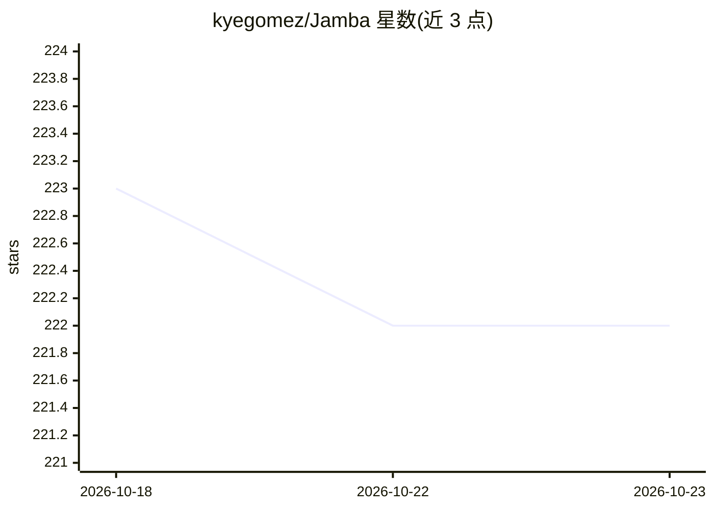

# kyegomez/Jamba

⭐ 222 · Python · MIT · 推送 2026-10-09 · [GitHub](https://github.com/kyegomez/Jamba) · [官网](https://discord.gg/7VckQVxvKk) · 个人维护

**Jamba 混合 Transformer-Mamba 语言模型的 PyTorch 实现**

论文《Jamba: A Hybrid Transformer-Mamba Language Model》的非官方 PyTorch 复现，提供模型实现、pip 安装包与使用示例，README 中含训练入口（python3 train.py）。仓库标注 Multi-Modality 与 MIT 许可。README 内容较少，未给出预训练权重、硬件要求或详细用法说明，主要面向希望阅读或运行该模型实现的研究者与开发者。

## 筛选速览

| 维度 | 判定 | 备注 |
|---|---|---|
| AI 角色 | `ai-native` | 本体是模型或模型工具 |
| 许可风险 | `permissive` | MIT |
| 部署形态 | `library` | 以包/库形式分发 |
| 模型依赖 | — | README 未给出锁定关系 |
| 硬件要求 | — | 无带数字的原话,不猜 |
| 安装摩擦 | `low` | 无编译、无系统依赖或容器化 |
| 成熟度 | — | 结构信号不足 |

## 能力要点

- Jamba（Transformer-Mamba 混合架构）的 PyTorch 实现
- 提供 pip install jamba 安装方式
- 含训练脚本入口 train.py

## 适用场景

- 研究 Transformer 与 Mamba 混合架构的实现细节
- 在自有数据上运行训练脚本
- 作为混合 SSM 语言模型的代码参考

## 场景标签

`模型训练` · 领域:训练与推理

## 证据(README 行号)

> L4: PyTorch Implementation of Jamba: "Jamba: A Hybrid Transformer-Mamba Language Model"
> L19: `python3 train.py`

## 星数曲线

2026-10-18 223 → 2026-10-23 222（-1）

---
*卡片 v1 · prompt 1.4 · 生成 2026-10-22 · 置信度 mid · 依据 README sha `9d495f5af7dc` · [字段定义](../../DATASET.md)*
