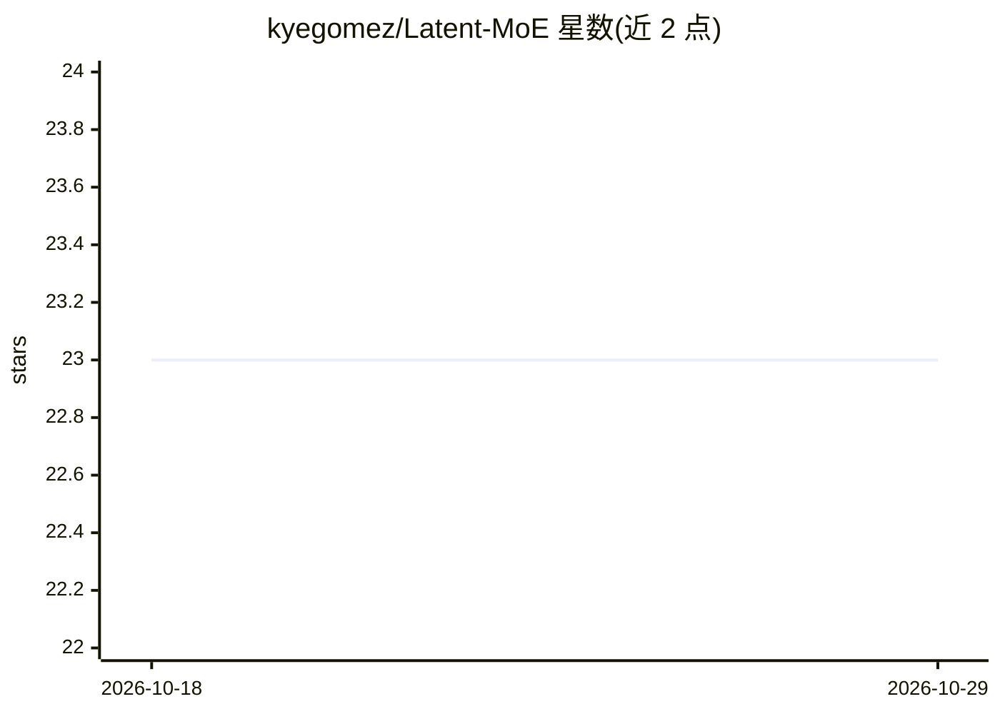

# kyegomez/Latent-MoE

⭐ 23 · Python · Apache-2.0 · 推送 2026-07-22 · [GitHub](https://github.com/kyegomez/Latent-MoE) · [官网](https://discord.gg/EamjgSaEQf) · 个人维护

**PyTorch 单文件 LatentMoE 层：降维计算专家以省通信与显存**

在 PyTorch 中实现 NVIDIA 2026 论文 LatentMoE：先用共享下投影把 token 从隐藏维度 d 压到潜在维度 l=d/alpha，在潜在空间运行路由专家再投影回原维度，使 all-to-all 通信量与每专家权重显存降为 1/alpha；节省的预算用于把专家数扩为 alpha*N，提供 l-MoE_eff（降成本）与 l-MoE_acc（提精度）两种模式。以可替换标准 MoE FFN 的单文件层形式提供，附带 MoETransformer 与 Wikipedia 流式训练脚本，面向 LLM 研究与开发者。

## 筛选速览

| 维度 | 判定 | 备注 |
|---|---|---|
| AI 角色 | `ai-ecosystem` | LLM/agent 周边工具 |
| 许可风险 | `permissive` | Apache-2.0 |
| 部署形态 | `library` | 以包/库形式分发 |
| 模型依赖 | — | README 未给出锁定关系 |
| 硬件要求 | — | 无带数字的原话,不猜 |
| 安装摩擦 | `low` | 无编译、无系统依赖或容器化 |
| 成熟度 | — | 结构信号不足 |

## 能力要点

- 共享下投影在潜在维度运行专家，通信量与显存降为 1/alpha
- l-MoE_eff / l-MoE_acc 两种成本-精度取舍模式
- 可替换标准 MoE FFN 的单文件、轻依赖层
- 附带 Muon+AdamW 训练脚本与 MoETransformer

## 适用场景

- 在自有 LLM 架构中替换标准 MoE FFN 层以降低推理成本
- 研究专家数量扩展与精度/FLOP 的权衡
- 用附带训练脚本在 Wikipedia/wikitext 上跑实验

## 场景标签

`模型训练` · 领域:训练与推理

## 证据(README 行号)

> L5: Implementation of LatentMoE: *Toward Optimal Accuracy per FLOP and Parameter in Mixture of Experts* (Elango et al., 
> L7: The idea is simple. A standard MoE routes and computes its experts in the model hidden dimension `d`. LatentMoE firs

## 星数曲线

2026-10-18 23 → 2026-10-29 23（+0）

---
*卡片 v1 · prompt 1.4 · 生成 2026-10-27 · 置信度 high · 依据 README sha `e406a0c23116` · [字段定义](../../DATASET.md)*
