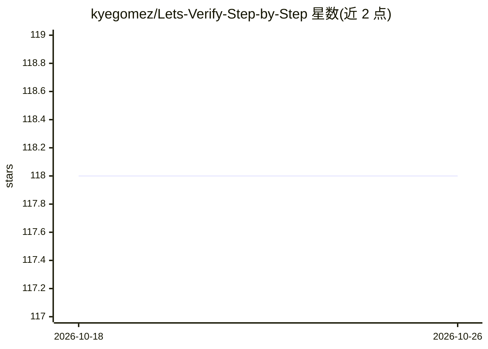

# kyegomez/Lets-Verify-Step-by-Step

⭐ 118 · Python · Apache-2.0 · 推送 2026-10-19 · [GitHub](https://github.com/kyegomez/Lets-Verify-Step-by-Step) · [官网](https://discord.gg/GYbXvDGevY) · 个人维护

**OpenAI 过程监督论文的 PyTorch 实现，含 PRM 奖励模型**

对 OpenAI 论文《Improving Mathematical Reasoning with Process Supervision》的实现，以 Python 包 process-supervision-torch 提供。核心组件包括 GPT4 封装与 PRM（Process Reward Model），支持 GPT4、GPT4+PRM 组合等用法，PRM 示例中搭配 swarms 的 OpenAIChat 调用 GPT-4。仓库 Todo 列表显示数学样本生成器集成、best-of-N 采样、用数据集训练/微调模型等功能尚未完成，属开发中状态。MIT 许可。

## 筛选速览

| 维度 | 判定 | 备注 |
|---|---|---|
| AI 角色 | `ai-native` | 本体是模型或模型工具 |
| 许可风险 | `permissive` | Apache-2.0 |
| 部署形态 | `library` | 以包/库形式分发 |
| 模型依赖 | — | README 未给出锁定关系 |
| 硬件要求 | — | 无带数字的原话,不猜 |
| 安装摩擦 | `low` | 无编译、无系统依赖或容器化 |
| 成熟度 | — | 结构信号不足 |

## 能力要点

- 实现 OpenAI 过程监督数学推理方法
- 提供 PRM（过程奖励模型）组件
- 支持 GPT4、GPT4+PRM 组合用法
- 以 pip 包 process-supervision-torch 分发

## 适用场景

- 复现过程监督奖励模型的数学推理方法
- 对 GPT-4 解题步骤做逐步奖励打分实验
- 作为过程监督相关研究的代码参考

## 场景标签

 · 领域:机器学习/推理与奖励模型

## 证据(README 行号)

> L2: Implementation of "Improving Mathematical Reasoning with Process Supervision" by OPENAI
> L20: from process_supervision.prm import PRM

## 星数曲线

2026-10-18 118 → 2026-10-26 118（+0）

---
*卡片 v1 · prompt 1.4 · 生成 2026-10-23 · 置信度 mid · 依据 README sha `7d3123cf04e2` · [字段定义](../../DATASET.md)*
