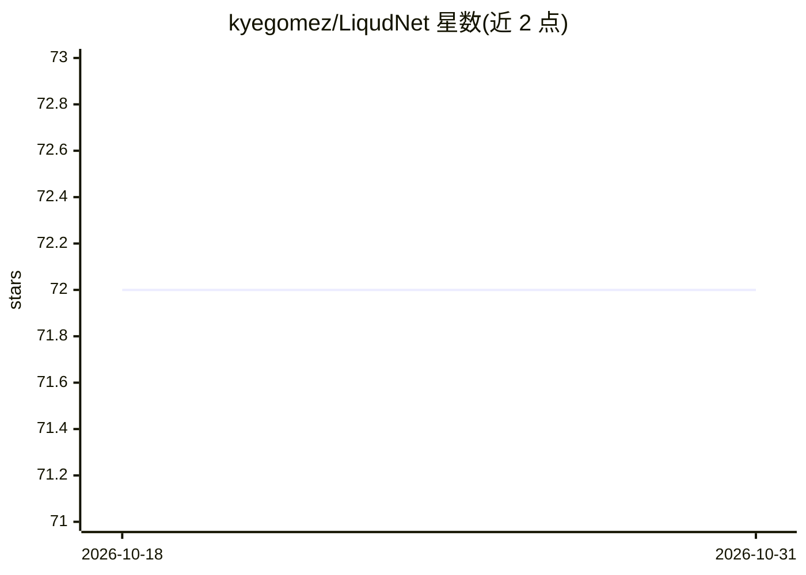

# kyegomez/LiqudNet

⭐ 72 · Python · MIT · 推送 2026-10-26 · [GitHub](https://github.com/kyegomez/LiqudNet) · [官网](https://discord.gg/GYbXvDGevY) · 个人维护

**LiquidNet（液态神经网络）的 PyTorch 实现，含视觉变体**

将 Liquid Net 官方仓库翻译为 PyTorch 的实现，提供 LiquidNet 模型类及代码示例；另含 VisionLiquidNet 变体（2 个卷积层加 2 个最大池化的简单模型，作者注明改进空间）。通过 pip 安装，README 的 Todo 列表中标注视觉版本在 CIFAR 上训练为待完成事项。引用 Hasani 与 Lechner 等人的论文，MIT 许可。

## 筛选速览

| 维度 | 判定 | 备注 |
|---|---|---|
| AI 角色 | `ai-native` | 本体是模型或模型工具 |
| 许可风险 | `permissive` | MIT |
| 部署形态 | `library` | 以包/库形式分发 |
| 模型依赖 | — | README 未给出锁定关系 |
| 硬件要求 | — | 无带数字的原话,不猜 |
| 安装摩擦 | `low` | 无编译、无系统依赖或容器化 |
| 成熟度 | — | 结构信号不足 |

## 能力要点

- PyTorch 版 LiquidNet 模型实现
- 提供 VisionLiquidNet 视觉变体（2 卷积 + 2 最大池化）
- pip install liquidnet 安装

## 适用场景

- 在 PyTorch 中实验液态神经网络结构
- 研究 Liquid Time-constant Networks 的复现与扩展
- 作为视觉任务模型结构的起点做改进

## 场景标签

`科研工具` · 领域:学习与行业

## 证据(README 行号)

> L4: This is a simple implementation of the Liquid net official repo translated into pytorch for simplicity. Find the ori
> L12: from liquidnet.main import LiquidNet

## 星数曲线

2026-10-18 72 → 2026-10-31 72（+0）

---
*卡片 v1 · prompt 1.4 · 生成 2026-10-24 · 置信度 high · 依据 README sha `87f12192b8f8` · [字段定义](../../DATASET.md)*
