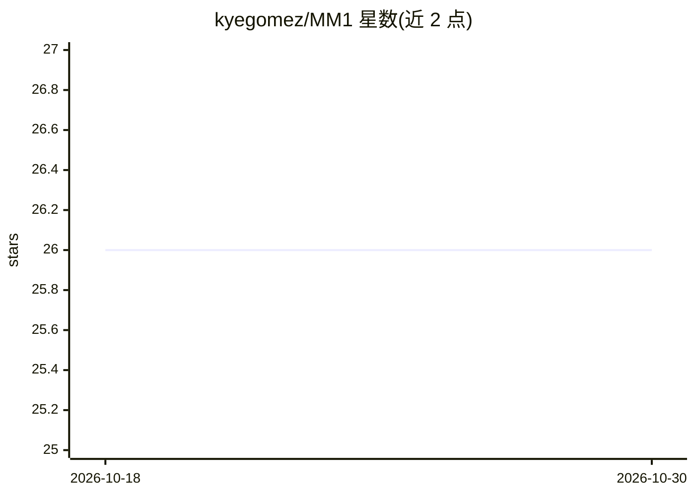

# kyegomez/MM1

⭐ 26 · Python · MIT · 推送 2026-10-26 · [GitHub](https://github.com/kyegomez/MM1) · [官网](https://discord.gg/7VckQVxvKk) · 个人维护

**论文 MM1 的 PyTorch 实现：多模态 LLM 预训练架构组件**

PyTorch 复现苹果论文《MM1: Methods, Analysis & Insights from Multimodal LLM Pre-training》中的多模态架构组件，遵循 img→encoder→connector→llm→tokens 流程，提供 MM1 模型类与 CAbstractor 连接器等模块的 Python API，通过 pip 安装 mm1-torch 使用。README 未提供训练脚本与权重，训练脚本（面向 Hugging Face datasets）与单元测试仍在 Todo 列表中，处于实现推进阶段。

## 筛选速览

| 维度 | 判定 | 备注 |
|---|---|---|
| AI 角色 | `ai-native` | 本体是模型或模型工具 |
| 许可风险 | `permissive` | MIT |
| 部署形态 | `library` | 以包/库形式分发 |
| 模型依赖 | — | README 未给出锁定关系 |
| 硬件要求 | — | 无带数字的原话,不猜 |
| 安装摩擦 | `low` | 无编译、无系统依赖或容器化 |
| 成熟度 | — | 结构信号不足 |

## 能力要点

- 实现论文 MM1 的多模态架构（encoder/connector/llm 流程）
- 提供 MM1 与 CAbstractor 等模块的 Python API
- 已实现 deformable attention

## 适用场景

- 研究多模态 LLM 预训练架构的实现细节
- 在 PyTorch 中复用 MM1 的连接器与注意力模块
- 基于论文组件搭建多模态实验原型

## 场景标签

`多模态` · 领域:感知与多模态

## 证据(README 行号)

> L4: PyTorch Implementation of the paper "MM1: Methods, Analysis & Insights from Multimodal LLM Pre-training".
> L6: `img -> encoder -> connector -> llm -> tokens`

## 星数曲线

2026-10-18 26 → 2026-10-30 26（+0）

---
*卡片 v1 · prompt 1.4 · 生成 2026-10-26 · 置信度 high · 依据 README sha `7b17d7780afe` · [字段定义](../../DATASET.md)*
