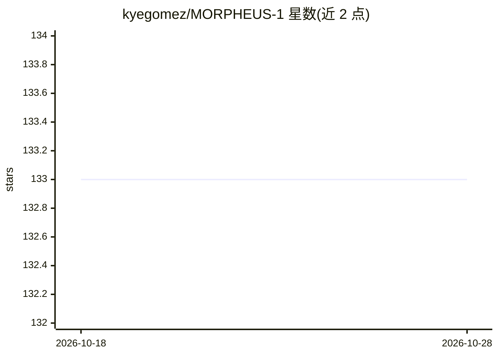

# kyegomez/MORPHEUS-1

⭐ 133 · Python · MIT · 推送 2026-10-26 · [GitHub](https://github.com/kyegomez/MORPHEUS-1) · [官网](https://discord.gg/GYbXvDGevY) · 个人维护

**MORPHEUS-1 论文复现：从 fMRI/EEG 生成超声调控的 Transformer**

对 Prophetic AI 提出的 MORPHEUS-1（用于诱导和稳定清醒梦的多模态生成式超声 Transformer）的 PyTorch 实现。模型读取 fMRI 张量与 EEG 嵌入作为输入，经编码器-解码器结构输出空间结果；输入张量形状在 README 中给出。以 pip 包 morpheus-torch 提供，MIT 许可。README 附带未完成的 Todo 列表，包括将多头注意力改为 Multi-Query Attention、核对张量形状与相关论文一致性。

## 筛选速览

| 维度 | 判定 | 备注 |
|---|---|---|
| AI 角色 | `ai-native` | 本体是模型或模型工具 |
| 许可风险 | `permissive` | MIT |
| 部署形态 | `library` | 以包/库形式分发 |
| 模型依赖 | — | README 未给出锁定关系 |
| 硬件要求 | — | 无带数字的原话,不猜 |
| 安装摩擦 | `low` | 无编译、无系统依赖或容器化 |
| 成熟度 | — | 结构信号不足 |

## 能力要点

- 多模态输入：fMRI 张量 (batch, channels, D, H, W) 与 EEG 嵌入
- 编码器-解码器 Transformer，解码器末端 scatter 输出空间结果
- pip 包 morpheus-torch 形式发布

## 适用场景

- 研究诱导/稳定清醒梦的生成式超声模型
- 复现 Prophetic AI 的 MORPHEUS-1 论文
- 在自有 fMRI/EEG 数据上实验该模型结构

## 场景标签

 · 领域:神经科学/医疗AI

## 证据(README 行号)

> L7: Implementation of "MORPHEUS-1" from Prophetic AI and "The world’s first multi-modal generative ultrasonic transforme
> L16: - The input is FRMI and EEG tensors.

## 星数曲线

2026-10-18 133 → 2026-10-28 133（+0）

---
*卡片 v1 · prompt 1.4 · 生成 2026-10-22 · 置信度 mid · 依据 README sha `1c3d776935c3` · [字段定义](../../DATASET.md)*
