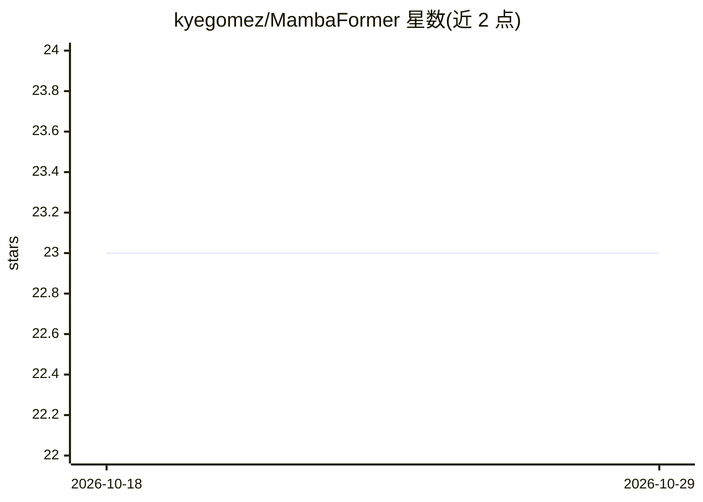

# kyegomez/MambaFormer

⭐ 23 · Python · MIT · 推送 2026-10-14 · [GitHub](https://github.com/kyegomez/MambaFormer) · [官网](https://discord.gg/7VckQVxvKk) · 个人维护

**PyTorch 实现的 MambaFormer 模型（论文复现库）**

基于 PyTorch 与 Zeta 框架实现的 MambaFormer，即论文《Can Mamba Learn How to Learn? A Comparative Study on In-Context Learning Tasks》中的模型结构，结合 SSM（Mamba）与注意力机制。面向研究者和开发者，可通过 pip 安装后 import 使用，提供基础调用示例代码。README 内容简短，仅包含安装、用法片段与 MIT 许可声明。

## 筛选速览

| 维度 | 判定 | 备注 |
|---|---|---|
| AI 角色 | `ai-native` | 本体是模型或模型工具 |
| 许可风险 | `permissive` | MIT |
| 部署形态 | `library` | 以包/库形式分发 |
| 模型依赖 | — | README 未给出锁定关系 |
| 硬件要求 | — | 无带数字的原话,不猜 |
| 安装摩擦 | `low` | 无编译、无系统依赖或容器化 |
| 成熟度 | — | 结构信号不足 |

## 能力要点

- PyTorch 实现 MambaFormer（Mamba SSM + 注意力机制组合）
- 基于 Zeta 框架构建
- 论文《Can Mamba Learn How to Learn?》的实现

## 适用场景

- 复现或验证论文中的 MambaFormer 实验结构
- 在自定义任务中调用 MambaFormer 模型做研究实验
- 学习 SSM 与注意力混合架构的实现方式

## 场景标签

 · 领域:深度学习/模型实现

## 证据(README 行号)

> L4: Implementation of MambaFormer in Pytorch ++ Zeta from the paper: "Can Mamba Learn How to Learn? A Comparative Study 
> L11: import torch

## 星数曲线

2026-10-18 23 → 2026-10-29 23（+0）

---
*卡片 v1 · prompt 1.4 · 生成 2026-10-27 · 置信度 high · 依据 README sha `83c40fa5f5c4` · [字段定义](../../DATASET.md)*
