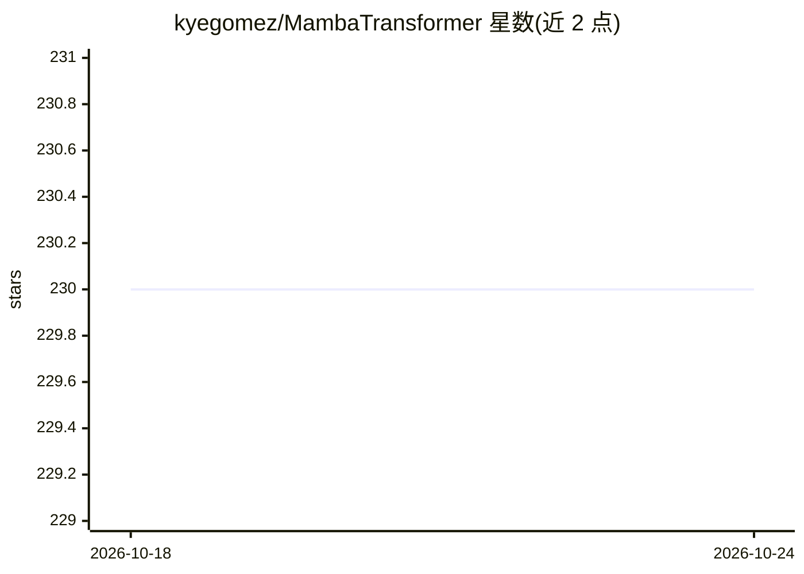

# kyegomez/MambaTransformer

⭐ 230 · Python · MIT · 推送 2026-10-09 · [GitHub](https://github.com/kyegomez/MambaTransformer) · [官网](https://discord.gg/GYbXvDGevY) · 个人维护

**融合 Mamba 与 Transformer 的序列建模 PyTorch 架构库**

自述为 100% 新设计的混合架构，将 SSM（Mamba）与注意力（Transformer）串联：x -> norm -> mamba -> norm -> transformer -> norm -> ffn -> norm -> out，层间加入多个归一化层以缓解两种架构整合带来的训练稳定性问题。目标为更快处理速度、更长上下文、更低困惑度。以 PyTorch 库形式提供，pip 安装后导入 MambaTransformer 类即可使用，MIT 许可。

## 筛选速览

| 维度 | 判定 | 备注 |
|---|---|---|
| AI 角色 | `ai-native` | 本体是模型或模型工具 |
| 许可风险 | `permissive` | MIT |
| 部署形态 | `library` | 以包/库形式分发 |
| 模型依赖 | — | README 未给出锁定关系 |
| 硬件要求 | — | 无带数字的原话,不猜 |
| 安装摩擦 | `low` | 无编译、无系统依赖或容器化 |
| 成熟度 | — | 结构信号不足 |

## 能力要点

- Mamba 与 Transformer 串联的混合架构定义
- 多层归一化以缓解双架构整合的训练稳定性问题
- PyTorch 库形式提供，pip 可安装

## 适用场景

- 长上下文序列建模任务的实验与研究
- 对比 SSM 与注意力混合结构的性能
- 作为自定义骨干网络嵌入 PyTorch 项目

## 场景标签

 · 领域:深度学习/模型架构

## 证据(README 行号)

> L7: Integrating Mamba/SSMs with Transformer for Enhanced Long Context and High-Quality Sequence Modeling.
> L11: The architecture is essentially: `x -> norm -> mamba -> norm -> transformer -> norm -> ffn -> norm -> out`.
> L16: `pip3 install mambatransformer`

## 星数曲线

2026-10-18 230 → 2026-10-24 230（+0）

---
*卡片 v1 · prompt 1.4 · 生成 2026-10-22 · 置信度 high · 依据 README sha `fee6e7c3f923` · [字段定义](../../DATASET.md)*
