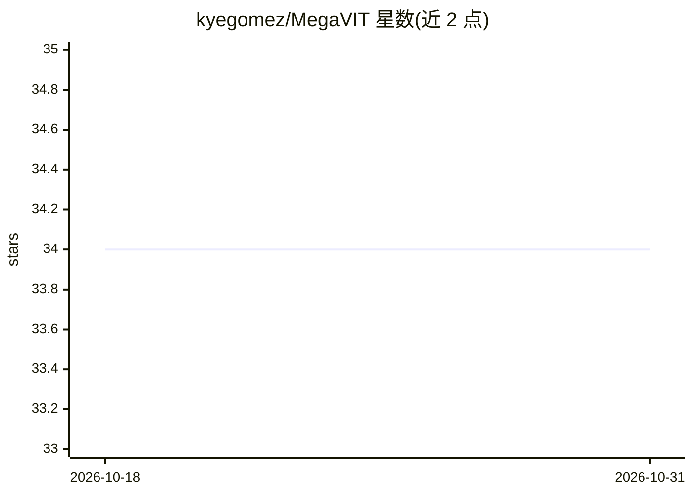

# kyegomez/MegaVIT

⭐ 34 · Python · MIT · 推送 2026-06-22 · [GitHub](https://github.com/kyegomez/MegaVIT) · [官网](https://discord.gg/qUtxnK2NMf) · 个人维护

**ViT-22B（220 亿参数视觉 Transformer）的开源实现**

论文 Scaling Vision Transformers to 22 Billion Parameters 中 ViT-22B 模型的开源 PyTorch 实现：采用并行层、Query/Key 归一化和省略偏置的结构，已加入 flash attention。提供 pip 安装、简单调用与论文超参两种用法示例，以及基于 CIFAR 的基础训练脚本（train.py），README 注明仍需自行调参才能找到可靠超参数。训练脚本尚未加入 FSDP。面向需要复现或使用该模型架构的计算机视觉研究者与开发者。

## 筛选速览

| 维度 | 判定 | 备注 |
|---|---|---|
| AI 角色 | `ai-native` | 本体是模型或模型工具 |
| 许可风险 | `permissive` | MIT |
| 部署形态 | `library` | 以包/库形式分发 |
| 模型依赖 | — | README 未给出锁定关系 |
| 硬件要求 | — | 无带数字的原话,不猜 |
| 安装摩擦 | `low` | 无编译、无系统依赖或容器化 |
| 成熟度 | — | 结构信号不足 |

## 能力要点

- ViT-22B 架构的开源 PyTorch 实现
- 并行层 + QK 归一化 + 省略偏置，已加入 flash attention
- 提供论文超参用法示例与基于 CIFAR 的训练脚本

## 适用场景

- 复现或研究 ViT-22B 的模型结构
- 在自定义数据上训练大规模视觉 Transformer
- 基于该实现做视觉表征相关的实验

## 场景标签

`模型训练` · 领域:训练与推理

## 证据(README 行号)

> L4: The open source implementation of the model from "Scaling Vision Transformers to 22 Billion Parameters"
> L36: # Model Architecture

## 星数曲线

2026-10-18 34 → 2026-10-31 34（+0）

---
*卡片 v1 · prompt 1.4 · 生成 2026-10-25 · 置信度 high · 依据 README sha `92b2876c555d` · [字段定义](../../DATASET.md)*
