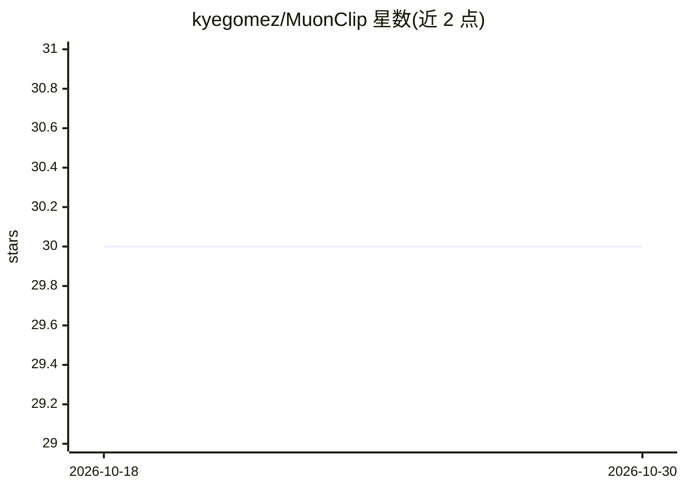

# kyegomez/MuonClip

⭐ 30 · Apache-2.0 · 推送 2025-11-07 · [GitHub](https://github.com/kyegomez/MuonClip) · [官网](https://discord.gg/jM3Z6M9uMq) · 个人维护

**Kimi K2 论文 MuonClip 策略的 PyTorch 开源实现**

以纯 PyTorch 实现 Kimi K2 论文（Moonshot AI）中的 MuonClip 训练策略，代码以 README 内嵌代码块形式提供，基于 torch 与 torch.nn 编写。面向需要复现或研究该优化策略的 LLM 训练开发者与科研人员。README 极简，仅含代码示例，无安装命令、依赖清单或用法说明，需读者自行将代码集成到训练流程中。

## 筛选速览

| 维度 | 判定 | 备注 |
|---|---|---|
| AI 角色 | `ai-ecosystem` | LLM/agent 周边工具 |
| 许可风险 | `permissive` | Apache-2.0 |
| 部署形态 | `None` |  |
| 模型依赖 | — | README 未给出锁定关系 |
| 硬件要求 | — | 无带数字的原话,不猜 |
| 安装摩擦 | `low` | 无编译、无系统依赖或容器化 |
| 成熟度 | — | 结构信号不足 |

## 能力要点

- 纯 PyTorch 实现 MuonClip 策略
- 对应 Kimi K2 论文（Moonshot AI）

## 适用场景

- 复现或研究 Kimi K2 的 MuonClip 训练策略
- 将该优化器策略集成到自己的 LLM 训练代码中

## 场景标签

`模型训练` · 领域:训练与推理

## 证据(README 行号)

> L3: This is a simple implementation of MuonClip in pure pytorch from the Kimi K2 Paper. Read it here

## 星数曲线

2026-10-18 30 → 2026-10-30 30（+0）

---
*卡片 v1 · prompt 1.4 · 生成 2026-10-26 · 置信度 mid · 依据 README sha `0824d1361129` · [字段定义](../../DATASET.md)*
