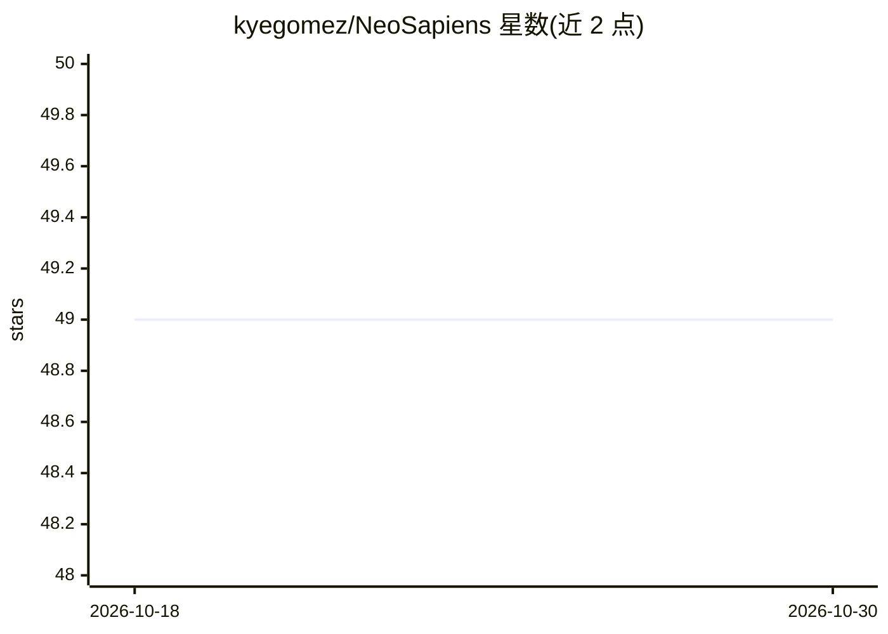

# kyegomez/NeoSapiens

⭐ 49 · Python · MIT · 推送 2026-10-26 · [GitHub](https://github.com/kyegomez/NeoSapiens) · [官网](https://discord.gg/x6XNynuZ) · 个人维护

**多智能体 swarm 运行库：一句话生成并运行 agent 团队**

基于 swarms 生态的 Python 库，提供 run_swarm 接口：输入自然语言任务描述后生成一组 AI agent 并以 swarm 方式协同执行（示例为创建自动驾驶系统的 agent 团队）。通过 pip 安装，依赖 swarms 包。README 中的 Todo 清单显示工具处理、工具路由、规则映射、boss agent 记忆（Chromadb）等功能尚未实现，处于早期开发阶段。MIT 许可。

## 筛选速览

| 维度 | 判定 | 备注 |
|---|---|---|
| AI 角色 | `ai-ecosystem` | LLM/agent 周边工具 |
| 许可风险 | `permissive` | MIT |
| 部署形态 | `library` | 以包/库形式分发 |
| 模型依赖 | — | README 未给出锁定关系 |
| 硬件要求 | — | 无带数字的原话,不猜 |
| 安装摩擦 | `low` | 无编译、无系统依赖或容器化 |
| 成熟度 | — | 结构信号不足 |

## 能力要点

- run_swarm 接口：自然语言任务生成并运行 agent swarm
- pip 安装，依赖 swarms 生态
- Todo 清单显示工具路由、规则处理、Chromadb 记忆等待实现

## 适用场景

- 用一句话生成 AI agent 团队执行复杂任务
- 作为 swarms 生态的多智能体编排组件试验

## 场景标签

`多智能体` · 领域:Agent 开发

## 证据(README 行号)

> L13: out = run_swarm("Create a self-driving car system using a team of AI agents")
> L6: `$ pip install -U swarms neo-sapiens`

## 星数曲线

2026-10-18 49 → 2026-10-30 49（+0）

---
*卡片 v1 · prompt 1.4 · 生成 2026-10-24 · 置信度 mid · 依据 README sha `85439c0e41b6` · [字段定义](../../DATASET.md)*
