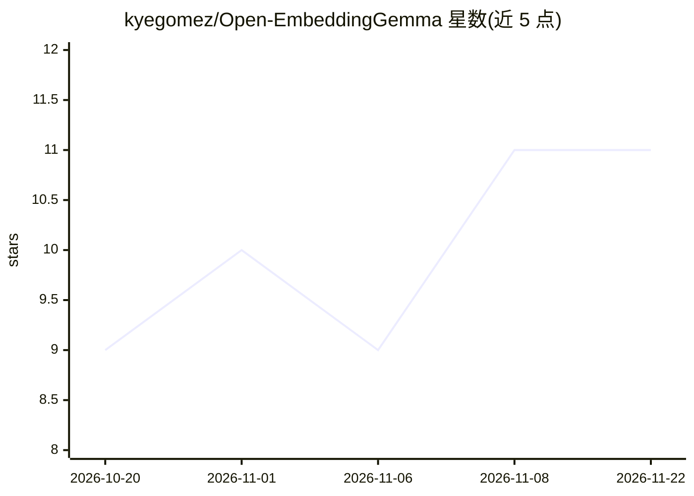

# kyegomez/Open-EmbeddingGemma

⭐ 11 · Python · Apache-2.0 · 推送 2026-10-09 · [GitHub](https://github.com/kyegomez/Open-EmbeddingGemma) · 个人维护

**PyTorch 实现的 740M 参数多模态嵌入模型 EmbeddingGemma 2**

以单文件 PyTorch 代码实现 Google DeepMind 的 EmbeddingGemma 2 多模态嵌入模型：文本、代码、图像、视频、音频经同一双向 Gemma 4 风格编码器输出 768 维单位向量。模块与参数名镜像官方 checkpoint，官方 safetensors 可直接加载。支持 Matryoshka 截断到 512/256/128 维，提供搜索问答、事实核查、代码检索等任务提示词。运行需 bfloat16 或 float32，float16 会因激活溢出被拒绝。

## 筛选速览

| 维度 | 判定 | 备注 |
|---|---|---|
| AI 角色 | `ai-native` | 本体是模型或模型工具 |
| 许可风险 | `permissive` | Apache-2.0 |
| 部署形态 | `library` | 以包/库形式分发 |
| 模型依赖 | — | README 未给出锁定关系 |
| 硬件要求 | — | 无带数字的原话,不猜 |
| 安装摩擦 | `low` | 无编译、无系统依赖或容器化 |
| 成熟度 | — | 结构信号不足 |

## 能力要点

- 文本/图像/视频/音频统一编码为 768 维向量
- 官方 safetensors 权重直接加载（参数名镜像）
- Matryoshka 截断支持 768/512/256/128 维
- 单文件实现，模型本体不依赖 transformers

## 适用场景

- 为文本、代码、图像、音视频生成统一空间的嵌入向量
- 语义搜索与文档检索（SearchQuery/Document 提示词）
- 聚类、分类、句子相似度等 MTEB 风格任务
- 按需截断到低维嵌入以节省存储

## 场景标签

`语义搜索` `多模态` · 领域:知识与检索

## 证据(README 行号)

> L5: Implementation of EmbeddingGemma 2, Google DeepMind's 740M parameter multimodal embedding model, in Pytorch
> L7: Text, code, images, video and audio (and any interleaving of them) all go through one bidirectional Gemma 4 style en
> L62: model = EmbeddingGemma2.from_pretrained('google/embeddinggemma-2').eval() # all modalities, 740M

## 星数曲线

2026-10-20 9 → 2026-11-22 11（+2）

---
*卡片 v1 · prompt 1.4 · 生成 2026-11-18 · 置信度 mid · 依据 README sha `32b66fb84e0c` · [字段定义](../../DATASET.md)*
