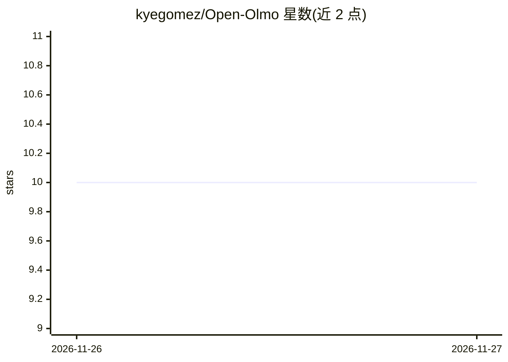

# kyegomez/Open-Olmo

⭐ 10 · Python · Apache-2.0 · 推送 2026-03-11 · [GitHub](https://github.com/kyegomez/Open-Olmo) · [官网](https://discord.gg/EamjgSaEQf) · 个人维护

**给研究者提供 OLMo Hybrid 架构的非官方 PyTorch 复现**

对 Allen Institute for AI（Ai2）提出的 OLMo Hybrid 架构的独立社区复现：模型将 Gated DeltaNet（线性 RNN）与带 RoPE 的因果多头注意力按 3:1 比例交替堆叠，支持顺序/分块两种循环形式、Flash Attention 分发、预置 1B/7B 配置、自回归生成与带状态推理。仅包含模型定义与示例，不含官方预训练权重、分词器或训练代码，安装仅依赖 PyTorch。

## 筛选速览

| 维度 | 判定 | 备注 |
|---|---|---|
| AI 角色 | `ai-native` | 本体是模型或模型工具 |
| 许可风险 | `permissive` | Apache-2.0 |
| 部署形态 | `library` | 以包/库形式分发 |
| 模型依赖 | — | README 未给出锁定关系 |
| 硬件要求 | — | 无带数字的原话,不猜 |
| 安装摩擦 | `low` | 无编译、无系统依赖或容器化 |
| 成熟度 | — | 结构信号不足 |

## 能力要点

- Gated DeltaNet 与 MHA 按 3:1 比例交替堆叠的混合架构实现
- 顺序与分块两种循环形式，推理时 DeltaNet 状态每步 O(1)
- 1B/7B 预置配置构造器与可复现的完整超参数参考
- 支持从缓存状态续接的有状态推理

## 适用场景

- 在 PyTorch 中实例化并运行 OLMo Hybrid 架构做前向与生成实验
- 研究线性 RNN 与注意力混合层的实现细节
- 作为论文复现的参考代码阅读架构设计

## 场景标签

`科研工具` · 领域:学习与行业

## 证据(README 行号)

> L29: **Unofficial** open-source PyTorch implementation of the OLMo Hybrid architecture introduced by the Allen Institute
> L41: The two layer types are interleaved in a fixed **3 : 1 ratio** (three DeltaNet layers for every one attention layer

## 星数曲线

2026-11-26 10 → 2026-11-27 10（+0）

---
*卡片 v1 · prompt 1.4 · 生成 2026-11-26 · 置信度 high · 依据 README sha `e0bf71a9ee1e` · [字段定义](../../DATASET.md)*
