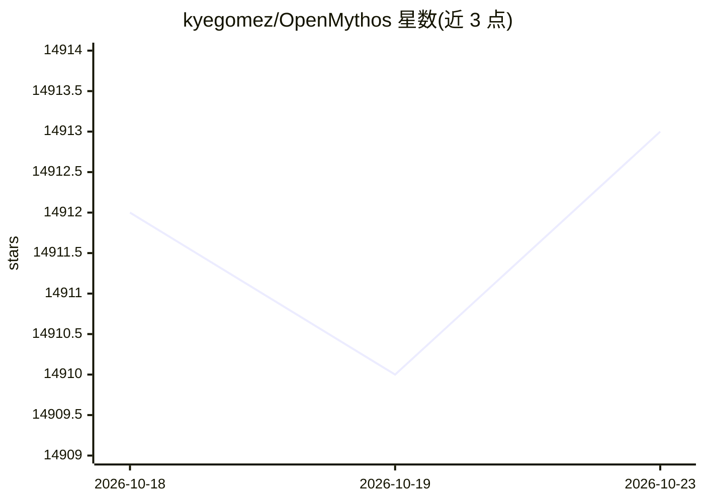

# kyegomez/OpenMythos

⭐ 14,913 · Python · MIT · 推送 2026-05-23 · [GitHub](https://github.com/kyegomez/OpenMythos) · [官网](https://discord.gg/EamjgSaEQf) · 个人维护

**对 Claude Mythos 架构的理论性开源重建：循环深度 Transformer 实现**

以 PyPI 包形式发布的理论性模型实现：按公开研究与猜测重建被称为 Claude Mythos 的架构，实现三段式 Recurrent-Depth Transformer（Prelude / 循环 Recurrent Block / Coda），注意力可在 MLA 与 GQA 间切换，前馈层为带路由与共享专家的稀疏 MoE。提供 1B 到 1T 参数的预配置变体、基于 FineWeb-Edu 的 3B 训练脚本（单卡与 torchrun 多卡）、API 文档，并附架构假设、稳定性约束与循环模型缩放律的说明。README 明确声明与 Anthropic 无关联。

## 筛选速览

| 维度 | 判定 | 备注 |
|---|---|---|
| AI 角色 | `ai-native` | 本体是模型或模型工具 |
| 许可风险 | `permissive` | MIT |
| 部署形态 | `library` | 以包/库形式分发 |
| 模型依赖 | — | README 未给出锁定关系 |
| 硬件要求 | — | 无带数字的原话,不猜 |
| 安装摩擦 | `medium` | 含编译或系统依赖之一 |
| 成熟度 | — | 结构信号不足 |

## 动量与使用信号

- 维护:`maintenance` — 距上次 push 147.9 天,年发版 0,1 位贡献者
- 涨星:近 1 天 **+1**(自 20261016 起算)
- 安装:pypi 包 `open-mythos` 月下载 97

## 能力要点

- 三段式 RDT 实现：Prelude、可循环 Recurrent Block（至多 max_loop_iters）、Coda
- 注意力可在 GQA（可选 Flash Attention 2）与 MLA（DeepSeek-V2 式压缩 KV 缓存）间切换
- 提供 1B–1T 参数的预配置变体与 3B FineWeb-Edu 训练脚本
- 通过参数化约束注入矩阵 A 使谱半径 ρ(A)<1，保证训练稳定性

## 适用场景

- 研究和实验循环/looped transformer 架构
- 在自有 GPU 上训练并复现 3B 规模的 RDT 模型
- 按论文描述的缩放律探索推理时循环深度的效果

## 场景标签

`模型训练` · 领域:训练与推理

## 证据(README 行号)

> L24: > **Disclaimer:** OpenMythos is an independent, community-driven theoretical reconstruction based solely on publicl
> L26: OpenMythos is an open-source, theoretical implementation of the Claude Mythos model. It implements a Recurrent-Dept
> L28: ## Installation

## 星数曲线

2026-10-18 14,912 → 2026-10-23 14,913（+1）

---
*卡片 v1 · prompt 1.4 · 生成 2026-10-18 · 置信度 high · 依据 README sha `954ee5889a6e` · [字段定义](../../DATASET.md)*
