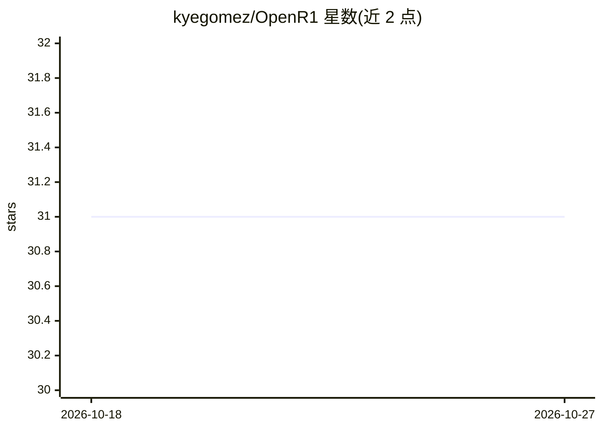

# kyegomez/OpenR1

⭐ 31 · Python · MIT · 推送 2026-10-26 · [GitHub](https://github.com/kyegomez/OpenR1) · [官网](https://swarms.ai) · 个人维护 · 中文 README

**DeepSeek R1 的开源复现，提供 GRPO 强化学习训练流程**

kyegomez 维护的开源项目，复现 DeepSeek R1 的训练方法：提供基于 GRPO（Group Relative Policy Optimization）的语言模型训练完整流程，含基础奖励模型与训练循环实现，并附训练流程的 mermaid 时序图（输入数据→策略网络→奖励模型）。以 Python 包形式通过 pip 安装，供需要复现或学习 R1 强化学习训练方法的研究者与开发者使用。README 内容较简短，未包含评测结果或文档细节。

## 筛选速览

| 维度 | 判定 | 备注 |
|---|---|---|
| AI 角色 | `ai-ecosystem` | LLM/agent 周边工具 |
| 许可风险 | `permissive` | MIT |
| 部署形态 | `library` | 以包/库形式分发 |
| 模型依赖 | — | README 未给出锁定关系 |
| 硬件要求 | — | 无带数字的原话,不猜 |
| 安装摩擦 | `low` | 无编译、无系统依赖或容器化 |
| 成熟度 | — | 结构信号不足 |

## 能力要点

- GRPO 强化学习训练完整流程实现
- 内置基础奖励模型与训练循环
- 提供训练流程时序图（输入数据→策略网络→奖励模型）

## 适用场景

- 复现 DeepSeek R1 的 GRPO 训练方法
- 学习语言模型强化学习训练流程
- 基于示例代码构建自己的 RL 训练管线

## 场景标签

`强化学习` · 领域:训练与推理

## 证据(README 行号)

> L1: # Open Implemenation of Deepseek's R1
> L15: This example demonstrates a complete pipeline for training a language model using GRPO.

## 星数曲线

2026-10-18 31 → 2026-10-27 31（+0）

---
*卡片 v1 · prompt 1.4 · 生成 2026-10-26 · 置信度 mid · 依据 README sha `3ad612646b73` · [字段定义](../../DATASET.md)*
