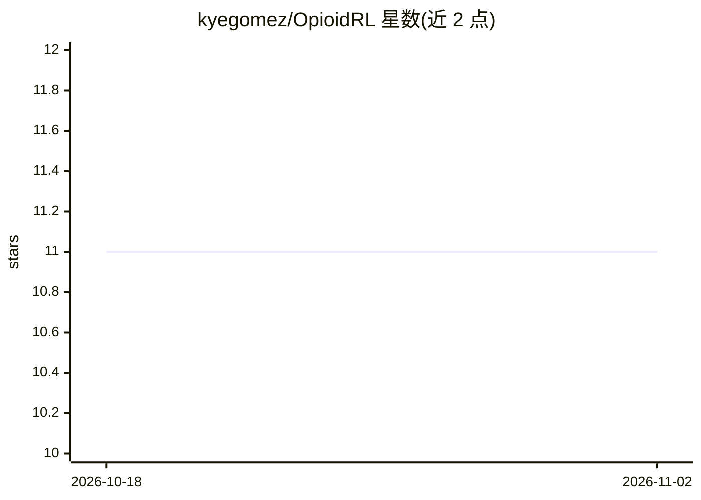

# kyegomez/OpioidRL

⭐ 11 · Python · MIT · 推送 2026-10-26 · [GitHub](https://github.com/kyegomez/OpioidRL) · [官网](https://discord.com/servers/agora-999382051935506503) · 组织维护

**模拟药物成瘾行为的强化学习环境库**

提供两个 Gym 风格的强化学习环境（Crack-v0 与 Meth-v0），在 RL 智能体中模拟奖赏依赖、高风险决策与强迫行为，并引入耐受、戒断与复吸等成瘾动态参数（可配置 tolerance_increase_rate、withdrawal_penalty、relapse_probability）。面向 RL 研究者与实验者，声称兼容 PyTorch、TensorFlow、Stable Baselines3 等框架，示例代码基于 Stable Baselines3 的 PPO/A2C。通过 pip 安装，声明仅为教育与研究用途。

## 筛选速览

| 维度 | 判定 | 备注 |
|---|---|---|
| AI 角色 | `ai-native` | 本体是模型或模型工具 |
| 许可风险 | `permissive` | MIT |
| 部署形态 | `library` | 以包/库形式分发 |
| 模型依赖 | — | README 未给出锁定关系 |
| 硬件要求 | — | 无带数字的原话,不猜 |
| 安装摩擦 | `low` | 无编译、无系统依赖或容器化 |
| 成熟度 | — | 结构信号不足 |

## 能力要点

- Crack-v0 与 Meth-v0 两个成瘾模拟环境
- 耐受、戒断、复吸等成瘾动态参数化配置
- 声称兼容任意 RL 框架（PyTorch/TensorFlow/SB3）
- 声明为教育与研究用途的抽象成瘾模型

## 适用场景

- 研究 RL 智能体的奖赏依赖与高风险决策
- 实验成瘾循环（耐受/戒断/复吸）对策略学习的影响
- 作为教学示例探索非常规奖赏结构的环境设计

## 场景标签

`强化学习` · 领域:训练与推理

## 证据(README 行号)

> L7: **OpioidRL** is a cutting-edge reinforcement learning (RL) library that simulates drug addiction behaviors within RL
> L15: - **Compatible with Any RL Framework**: Easily integrate OpioidRL with popular RL frameworks like PyTorch, TensorFl

## 星数曲线

2026-10-18 11 → 2026-11-02 11（+0）

---
*卡片 v1 · prompt 1.4 · 生成 2026-11-02 · 置信度 high · 依据 README sha `2ac14a10aaa5` · [字段定义](../../DATASET.md)*
