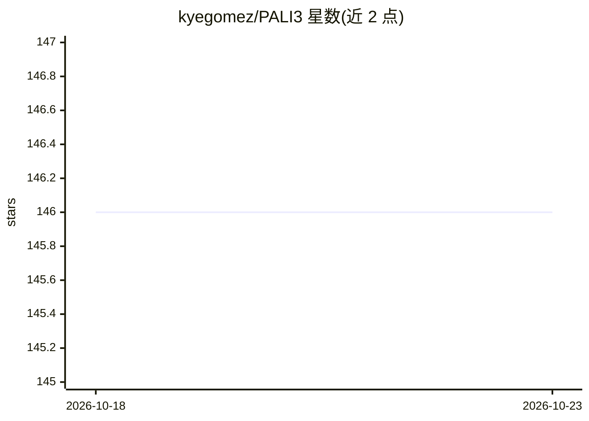

# kyegomez/PALI3

⭐ 146 · Python · MIT · 推送 2026-10-09 · [GitHub](https://github.com/kyegomez/PALI3) · [官网](https://discord.gg/qUtxnK2NMf) · 个人维护

**PaLI-3 视觉语言模型的开源实现库：图像+文本生成回答**

kyegomez 对论文 PaLI-3 (5B) 的 PyTorch 实现：SigLIP 对比预训练 ViT 视觉编码器将图像转为视觉 token，与查询文本 token 一同输入 3B UL2 编码器-解码器生成文本输出。README 给出四阶段训练流程（单模态预训练、多模态训练、分辨率提升、任务微调）与论文数据集表。实现进度不完整：视觉 token 前接与完整训练脚本仍在 Todo 中。pip 安装为 Python 库形态。

## 筛选速览

| 维度 | 判定 | 备注 |
|---|---|---|
| AI 角色 | `ai-native` | 本体是模型或模型工具 |
| 许可风险 | `permissive` | MIT |
| 部署形态 | `library` | 以包/库形式分发 |
| 模型依赖 | — | README 未给出锁定关系 |
| 硬件要求 | — | 无带数字的原话,不猜 |
| 安装摩擦 | `low` | 无编译、无系统依赖或容器化 |
| 成熟度 | — | 结构信号不足 |

## 能力要点

- SigLIP ViT 视觉编码 + 3B UL2 编码器-解码器架构实现
- 多阶段训练流程（单模态预训练→多模态→分辨率提升→任务微调）说明
- 汇总论文 15 个预训练/评测数据集及来源链接

## 适用场景

- 研究 PaLI-3 视觉语言模型架构的实现细节
- 在自有数据集上复现或扩展多模态问答训练
- 学习 SigLIP + UL2 组合的代码结构

## 场景标签

`多模态` · 领域:感知与多模态

## 证据(README 行号)

> L6: "Figure 1: Overview of the PaLI-3 (5B) model: images are encoded into visual tokens individually
> L8: are passed to an 3B encoder-decoder UL2 Transformer which produces the desired answer."

## 星数曲线

2026-10-18 146 → 2026-10-23 146（+0）

---
*卡片 v1 · prompt 1.4 · 生成 2026-10-23 · 置信度 high · 依据 README sha `a7c5b752ee3f` · [字段定义](../../DATASET.md)*
