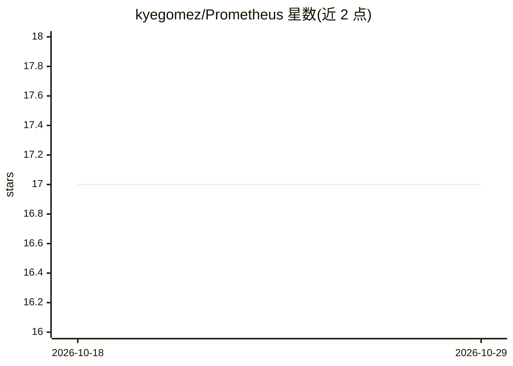

# kyegomez/Prometheus

⭐ 17 · Python · MIT · 推送 2026-10-26 · [GitHub](https://github.com/kyegomez/Prometheus) · [官网](https://discord.com/servers/agora-999382051935506503) · 个人维护

**按自然语言描述生成想象生物 DNA 序列的 AI 模型**

Prometheus 是一个生成式 AI 模型，接受自然语言描述（如“粉色蓝眼熊猫”），提取表型性状，映射到基因标记并合成完整或部分 DNA 序列，可修改颜色、体型、行为等特定性状，并提供生存与适应能力的可行性模拟。提供 Python API 与命令行用法，通过 git clone 源码加 pip 安装依赖运行。README 同时列出 GWAS Catalog、UK Biobank 等表型-基因型数据集作为相关资源，并用大量篇幅描述将生成序列转化为真实生物体所需的理论合成生物学流程。

## 筛选速览

| 维度 | 判定 | 备注 |
|---|---|---|
| AI 角色 | `ai-native` | 本体是模型或模型工具 |
| 许可风险 | `permissive` | MIT |
| 部署形态 | `library` | 以包/库形式分发 |
| 模型依赖 | — | README 未给出锁定关系 |
| 硬件要求 | — | 无带数字的原话,不猜 |
| 安装摩擦 | `low` | 无编译、无系统依赖或容器化 |
| 成熟度 | — | 结构信号不足 |

## 能力要点

- 自然语言描述生成完整或部分基因组
- 表型-基因型映射与特定性状（颜色/体型/行为）修改
- 可行性模拟报告生成生物的生存适应情况
- 可扩展 API 接入 CRISPR 模拟器等合成生物学工具

## 适用场景

- 用自然语言描述想象生物并生成其 DNA 序列
- 修改现有物种的特定基因以改变性状
- 模拟评估生成基因组的生物可行性

## 场景标签

 · 领域:生物/基因组学 AI

## 证据(README 行号)

> L7: Welcome to **Prometheus**, the AI model that allows you to generate DNA sequences for any creature you can imagine. 
> L11: **Prometheus** is a state-of-the-art AI-powered tool that bridges the gap between imagination and reality by genera
> L13: - **Generate entire genomes** for real or imaginary animals.

## 星数曲线

2026-10-18 17 → 2026-10-29 17（+0）

---
*卡片 v1 · prompt 1.4 · 生成 2026-10-29 · 置信度 mid · 依据 README sha `1b3b16a95d5f` · [字段定义](../../DATASET.md)*
