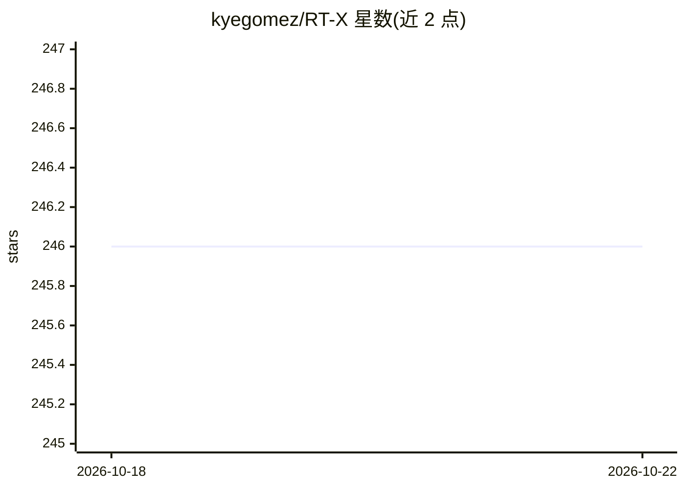

# kyegomez/RT-X

⭐ 246 · Python · MIT · 推送 2026-10-09 · [GitHub](https://github.com/kyegomez/RT-X) · [官网](https://discord.gg/qUtxnK2NMf) · 个人维护

**RT-1-X/RT-2-X 机器人模型的 PyTorch 复现库**

对论文《Open X-Embodiment: Robotic Learning Datasets and RT-X Models》中 RT-1-X 与 RT-2-X 模型架构的 PyTorch 实现：RTX1 接收文本与视频输入，采用 Film-EfficientNet 骨干（论文实现改用 MaxViT）；RTX2 将图像与文本交错组成多模态序列，输出文本 token 而非 7 维动作向量。另提供 EfficientNetFilm 图像特征提取模块。以 pip 包形式发布，附 pytest 测试。RTX1 尚未集成 EfficientNet，训练脚本仍在 Todo 列表中。

## 筛选速览

| 维度 | 判定 | 备注 |
|---|---|---|
| AI 角色 | `ai-native` | 本体是模型或模型工具 |
| 许可风险 | `permissive` | MIT |
| 部署形态 | `library` | 以包/库形式分发 |
| 模型依赖 | — | README 未给出锁定关系 |
| 硬件要求 | — | 无带数字的原话,不猜 |
| 安装摩擦 | `low` | 无编译、无系统依赖或容器化 |
| 成熟度 | — | 结构信号不足 |

## 能力要点

- RT-1-X 与 RT-2-X 双模型架构的 PyTorch 实现
- RTX2 将图文交错为多模态序列并输出文本 token
- 提供 EfficientNetFilm 图像特征提取模块
- 附 pytest 测试文件

## 适用场景

- 机器人学习研究者复现 RT-X 论文模型
- 基于 RTX1/RTX2 架构做机器人视觉-语言-动作实验
- 复用 EfficientNetFilm 做图像特征提取

## 场景标签

`多模态` · 领域:感知与多模态

## 证据(README 行号)

> L4: Pytorch implementation of the models RT-1-X and RT-2-X from the paper: "Open X-Embodiment: Robotic Learning Datasets
> L34: - RTX-2 takes in images and text and interleaves them to form multi-modal sentences and outputs text tokens not a 7

## 星数曲线

2026-10-18 246 → 2026-10-22 246（+0）

---
*卡片 v1 · prompt 1.4 · 生成 2026-10-22 · 置信度 high · 依据 README sha `7a98469e2666` · [字段定义](../../DATASET.md)*
