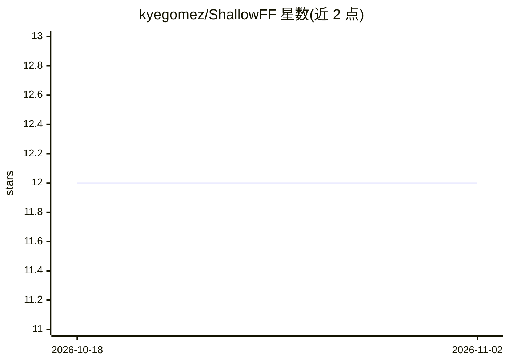

# kyegomez/ShallowFF

⭐ 12 · Python · MIT · 推送 2026-10-26 · [GitHub](https://github.com/kyegomez/ShallowFF) · [官网](https://discord.gg/Yx5y5VBahs) · 个人维护

**用浅层前馈网络替代注意力层的 Transformer 实现**

论文《Rethinking Attention: Exploring Shallow Feed-Forward Neural Networks as an Alternative to Attention Layers in Transformers》的 Zeta 实现，以 PyTorch 提供 ALRTransformer 模块：将原 Transformer 的联合编码器+解码器结构替换为前馈/ALR 块加解码器。通过 pip 安装 alr-transformer 后导入使用，或 git clone 仓库运行 train.py 训练。README 附论文引用信息，支持多模态（标题声明）。

## 筛选速览

| 维度 | 判定 | 备注 |
|---|---|---|
| AI 角色 | `ai-native` | 本体是模型或模型工具 |
| 许可风险 | `permissive` | MIT |
| 部署形态 | `library` | 以包/库形式分发 |
| 模型依赖 | — | README 未给出锁定关系 |
| 硬件要求 | — | 无带数字的原话,不猜 |
| 安装摩擦 | `low` | 无编译、无系统依赖或容器化 |
| 成熟度 | — | 结构信号不足 |

## 能力要点

- ALR 前馈块替代注意力层的 Transformer 结构实现
- 提供 PyTorch 模块 ALRTransformer 可直接导入
- 附 train.py 训练脚本与论文引用

## 适用场景

- 研究者复现浅层前馈替代注意力的论文实验
- 在自己的 PyTorch 项目中试用 ALR Transformer 结构
- 对比注意力机制与前馈替代方案的建模效果

## 场景标签

 · 领域:深度学习/模型架构

## 证据(README 行号)

> L4: ALR Transformer that replaces the original transformer implementation of an joint encoder + decoder block with a fee
> L11: import torch

## 星数曲线

2026-10-18 12 → 2026-11-02 12（+0）

---
*卡片 v1 · prompt 1.4 · 生成 2026-11-01 · 置信度 mid · 依据 README sha `eaefe7599882` · [字段定义](../../DATASET.md)*
