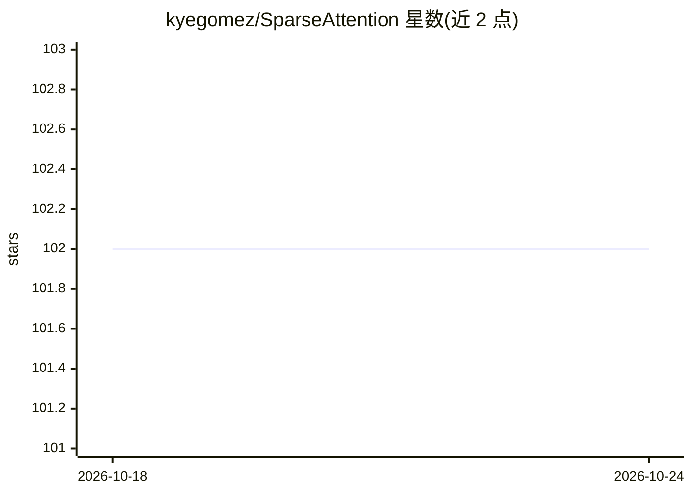

# kyegomez/SparseAttention

⭐ 102 · Python · MIT · 推送 2026-10-09 · [GitHub](https://github.com/kyegomez/SparseAttention) · [官网](https://discord.gg/GYbXvDGevY) · 个人维护

**稀疏注意力机制的 PyTorch 实现库，处理长序列**

论文 Generating Long Sequences with Sparse Transformers 的稀疏注意力 PyTorch 实现：提供 SparseAttention 类及 attention_impl、blocksparse_attention_impl 函数，输入 query/key/value 张量与稀疏掩码，支持 all、local、strided 三种注意力模式，按 block size 粒度选取元素对计算注意力分数，将序列长度上的计算复杂度由二次降为线性。面向需要在自有模型中集成稀疏注意力的深度学习开发者，以 Python 模块形式提供；README 未给出安装命令与预训练权重。

## 筛选速览

| 维度 | 判定 | 备注 |
|---|---|---|
| AI 角色 | `ai-native` | 本体是模型或模型工具 |
| 许可风险 | `permissive` | MIT |
| 部署形态 | `None` |  |
| 模型依赖 | — | README 未给出锁定关系 |
| 硬件要求 | — | 无带数字的原话,不猜 |
| 安装摩擦 | `low` | 无编译、无系统依赖或容器化 |
| 成熟度 | — | 结构信号不足 |

## 能力要点

- SparseAttention 类接受 q/k/v 张量与定义稀疏模式的掩码
- attention_impl 与 blocksparse_attention_impl 支持密集和块稀疏两种模式
- 支持 all/local/strided 三种注意力模式与 block size 参数
- 对应论文 arXiv:1904.10509 的实现

## 适用场景

- 在长文本任务中替换全量注意力以降低计算量
- 在自有 Transformer 模型中集成块稀疏注意力层
- 实验对比固定与可学习稀疏模式的效果

## 场景标签

 · 领域:深度学习/模型组件

## 证据(README 行号)

> L37: In our implementation, we define a `SparseAttention` class that performs the sparse attention operation. The class 
> L41: We also provide `attention_impl` and `blocksparse_attention_impl` functions, which implement the attention operatio

## 星数曲线

2026-10-18 102 → 2026-10-24 102（+0）

---
*卡片 v1 · prompt 1.4 · 生成 2026-10-23 · 置信度 high · 依据 README sha `9ffad5c3e91f` · [字段定义](../../DATASET.md)*
