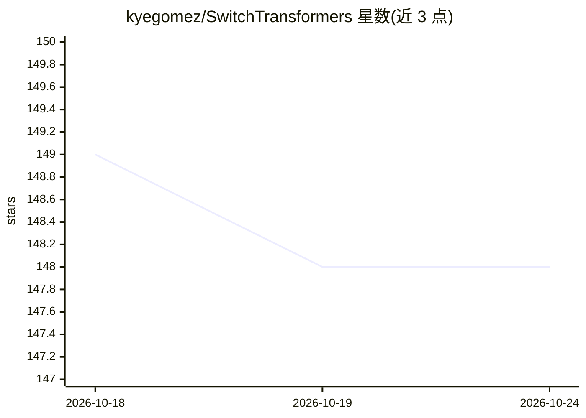

# kyegomez/SwitchTransformers

⭐ 148 · Python · MIT · 推送 2026-10-09 · [GitHub](https://github.com/kyegomez/SwitchTransformers) · [官网](https://discord.gg/GYbXvDGevY) · 个人维护

**PyTorch 实现的 Switch Transformers（MoE 稀疏模型）**

基于论文《Switch Transformers: Scaling to Trillion Parameter Models with Simple and Efficient Sparsity》的 PyTorch 实现，使用 Einops 与 Zeta 库构建混合专家（MoE）稀疏架构。以 Python 库形式提供，pip 安装后可 import SwitchTransformer 类并在代码中使用。README 较简短，仅包含安装、基本用法示例与论文引用信息，未提供训练细节或预训练权重说明。MIT 许可证。

## 筛选速览

| 维度 | 判定 | 备注 |
|---|---|---|
| AI 角色 | `ai-native` | 本体是模型或模型工具 |
| 许可风险 | `permissive` | MIT |
| 部署形态 | `library` | 以包/库形式分发 |
| 模型依赖 | — | README 未给出锁定关系 |
| 硬件要求 | — | 无带数字的原话,不猜 |
| 安装摩擦 | `low` | 无编译、无系统依赖或容器化 |
| 成熟度 | — | 结构信号不足 |

## 能力要点

- Switch Transformers 论文的 PyTorch 实现
- 基于 Einops 与 Zeta 构建的 MoE 稀疏架构
- pip install switch-transformers 安装，代码中直接调用 SwitchTransformer 类

## 适用场景

- 在 PyTorch 项目中引入 MoE 架构的 Transformer 实现
- 复现或实验 Switch Transformers 论文中的稀疏模型结构
- 学习混合专家层的代码实现方式

## 场景标签

 · 领域:深度学习/模型实现

## 证据(README 行号)

> L7: Implementation of Switch Transformers from the paper: "Switch Transformers: Scaling to Trillion Parameter Models wit
> L18: from switch_transformers import SwitchTransformer

## 星数曲线

2026-10-18 149 → 2026-10-24 148（-1）

---
*卡片 v1 · prompt 1.4 · 生成 2026-10-22 · 置信度 high · 依据 README sha `c79561c6f64e` · [字段定义](../../DATASET.md)*
