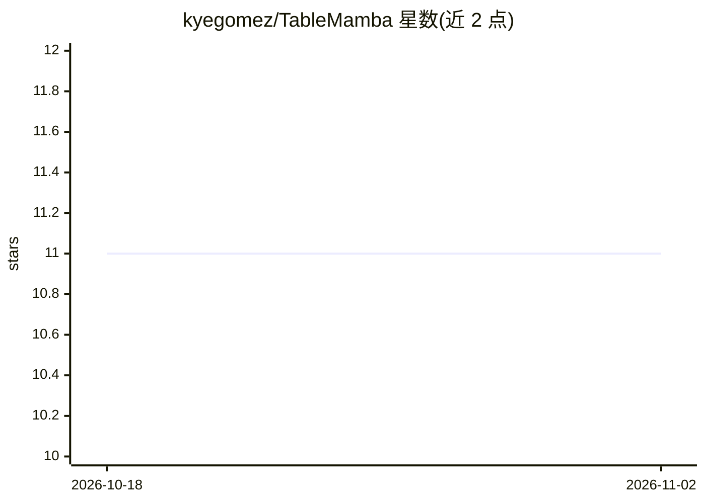

# kyegomez/TableMamba

⭐ 11 · Python · Apache-2.0 · 推送 2026-05-29 · [GitHub](https://github.com/kyegomez/TableMamba) · [官网](https://swarms.ai) · 个人维护

**基于 Mamba 的序列推荐模型：多兴趣 SSM 头按对数间隔时标编码用户历史**

TableMamba 是 PyTorch 实现的序列推荐模型：以 Mamba 选择性状态空间块替换 Transformer 注意力主干，将用户交互历史压缩为固定大小递归状态；用 M 个并行 SSM 读取头（对数间隔时标 τ_m）表示短/中/长期兴趣，打分取物品与最佳匹配兴趣的内积，复杂度 O(T)。训练采用硬路由采样 softmax 并配多样性与负载均衡正则；推理可将稠密打分替换为逐头 ANN 查询。默认纯 PyTorch 实现，支持 CPU/MPS/CUDA，CUDA 上可换用 mamba_ssm 的 Mamba3 内核。

## 筛选速览

| 维度 | 判定 | 备注 |
|---|---|---|
| AI 角色 | `ai-native` | 本体是模型或模型工具 |
| 许可风险 | `permissive` | Apache-2.0 |
| 部署形态 | `library` | 以包/库形式分发 |
| 模型依赖 | — | README 未给出锁定关系 |
| 硬件要求 | — | 无带数字的原话,不猜 |
| 安装摩擦 | `medium` | 含编译或系统依赖之一 |
| 成熟度 | — | 结构信号不足 |

## 能力要点

- Mamba 选择性 SSM 主干以 O(T) 替代注意力的 O(T²)
- M 个并行 SSM 读取头表示多时间尺度兴趣，打分取最佳匹配兴趣
- 硬路由采样 softmax 训练，配多样性损失与负载均衡损失
- 默认纯 PyTorch 实现可在 CPU/MPS/CUDA 运行，CUDA 可换 Mamba3 内核

## 适用场景

- 为推荐系统构建基于用户交互历史的下一物品预测模型
- 长序列、时间跨度大的用户行为序列建模
- 生产部署中按兴趣头做 ANN 检索并合并结果

## 场景标签

`推荐系统` · 领域:学习与行业

## 证据(README 行号)

> L3: Implementation of **TableMamba**, a selective state-space sequential recommender that swaps the attention trunk of a
> L57: **Selective SSM.** Each block runs the S6 / Mamba selective scan: `x_proj` produces input-dependent `(Δ, B, C)` per

## 星数曲线

2026-10-18 11 → 2026-11-02 11（+0）

---
*卡片 v1 · prompt 1.4 · 生成 2026-11-02 · 置信度 high · 依据 README sha `ce0007f348c3` · [字段定义](../../DATASET.md)*
