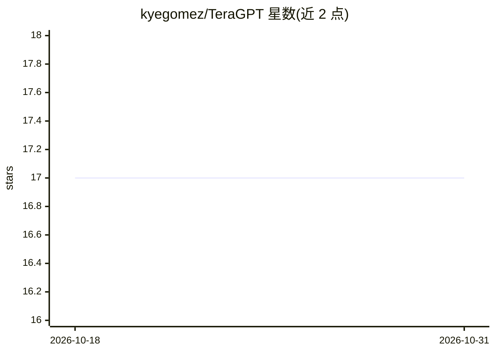

# kyegomez/TeraGPT

⭐ 17 · Python · MIT · 推送 2026-10-26 · [GitHub](https://github.com/kyegomez/TeraGPT) · [官网](https://discord.gg/GYbXvDGevY) · 个人维护

**训练 GPT-3 规模大模型的极简 PyTorch 训练框架（350 行）**

受 nanoGPT 启发的 LLM 训练实现：以单一份 model.py 与 train.py（合计约 350 行）覆盖训练逻辑，基于 Zeta 框架实现权重流式执行与跨机数据并行，面向数十至数百亿参数规模模型的集群训练。README 称已测试至 175B 参数规模可功能正常运行，并支持加载 HuggingFace tokenizer（llama-tokenizer 示例）。通过环境变量（MASTER_ADDR/RANK/WORLD_SIZE）配置分布式训练，以 pip 安装、python train.py 运行。与 Megatron-LM 做了代码行数对比。

## 筛选速览

| 维度 | 判定 | 备注 |
|---|---|---|
| AI 角色 | `ai-ecosystem` | LLM/agent 周边工具 |
| 许可风险 | `permissive` | MIT |
| 部署形态 | `library` | 以包/库形式分发 |
| 模型依赖 | — | README 未给出锁定关系 |
| 硬件要求 | — | 无带数字的原话,不猜 |
| 安装摩擦 | `medium` | 含编译或系统依赖之一 |
| 成熟度 | — | 结构信号不足 |

## 能力要点

- train.py + model.py 合计约 350 行 PyTorch 代码
- 权重流式执行模式与跨机数据并行扩展
- README 称已测试 175B 参数规模模型运行正确
- 支持 HuggingFace tokenizer（示例为 llama-tokenizer）

## 适用场景

- 在集群上以简洁代码库训练 GPT-3 规模模型
- 教学/研究中阅读完整的大模型训练逻辑
- 对比学习 nanoGPT 之上的规模化训练方案

## 场景标签

`模型训练` · 领域:训练与推理

## 证据(README 行号)

> L4: Zeta present TeraGPT – the simplest implementation for training large language models with tens or hundreds of billi
> L30: `trainer.py` sets up the environment for distributed training and then initializes a `Trainer` object to start the 

## 星数曲线

2026-10-18 17 → 2026-10-31 17（+0）

---
*卡片 v1 · prompt 1.4 · 生成 2026-10-29 · 置信度 high · 依据 README sha `bc25db9e15b9` · [字段定义](../../DATASET.md)*
