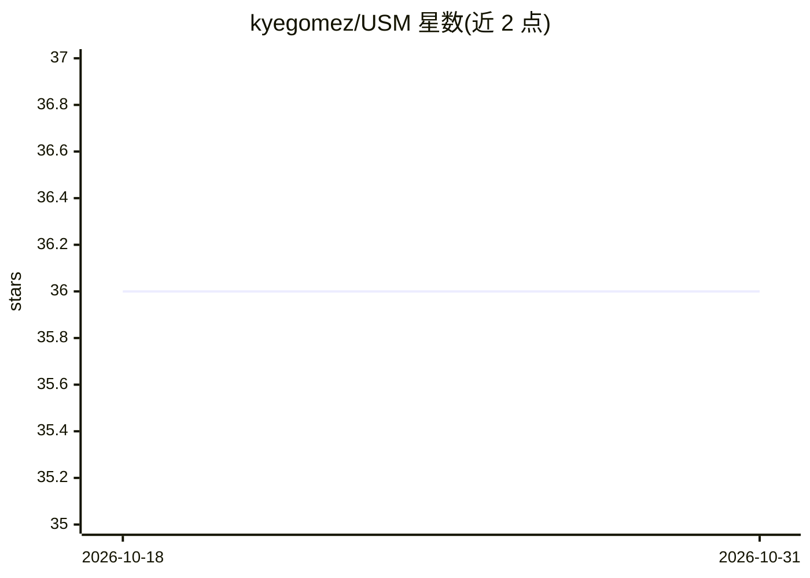

# kyegomez/USM

⭐ 36 · Python · MIT · 推送 2026-10-26 · [GitHub](https://github.com/kyegomez/USM) · [官网](https://discord.gg/GYbXvDGevY) · 个人维护

**Google USM 语音模型的 PyTorch 复现实现**

对论文 Google USM: Scaling Automatic Speech Recognition Beyond 100 Languages 的 PyTorch 实现，提供 USMEncoder 等模块，可通过 pip 安装 usm-torch 后以 Python 代码调用。README 中 Todo 列表显示多项组件尚未完成（codebook 余弦相似度、chunk-wise attention、RNN-T 重构损失、文本编码器等），属于进行中的实现。采用 MIT 许可，附论文 BibTeX 引用。

## 筛选速览

| 维度 | 判定 | 备注 |
|---|---|---|
| AI 角色 | `ai-native` | 本体是模型或模型工具 |
| 许可风险 | `permissive` | MIT |
| 部署形态 | `library` | 以包/库形式分发 |
| 模型依赖 | — | README 未给出锁定关系 |
| 硬件要求 | — | 无带数字的原话,不猜 |
| 安装摩擦 | `low` | 无编译、无系统依赖或容器化 |
| 成熟度 | — | 结构信号不足 |

## 能力要点

- Google USM 语音模型的 PyTorch 实现
- pip 安装 usm-torch，代码中调用 USMEncoder
- Todo 列表标注多项组件尚未实现（RNN-T、chunk-wise attention 等）

## 适用场景

- 研究 USM 语音模型架构的 PyTorch 源码
- 基于 USMEncoder 搭建语音编码实验
- 跟进 USM 论文的开源复现进度

## 场景标签

`语音识别` · 领域:感知与多模态

## 证据(README 行号)

> L4: Implementation of Google's universal speech model from the paper: Google USM: Scaling Automatic Speech Recognition B
> L12: import torch

## 星数曲线

2026-10-18 36 → 2026-10-31 36（+0）

---
*卡片 v1 · prompt 1.4 · 生成 2026-10-25 · 置信度 high · 依据 README sha `31c5df80f2fd` · [字段定义](../../DATASET.md)*
