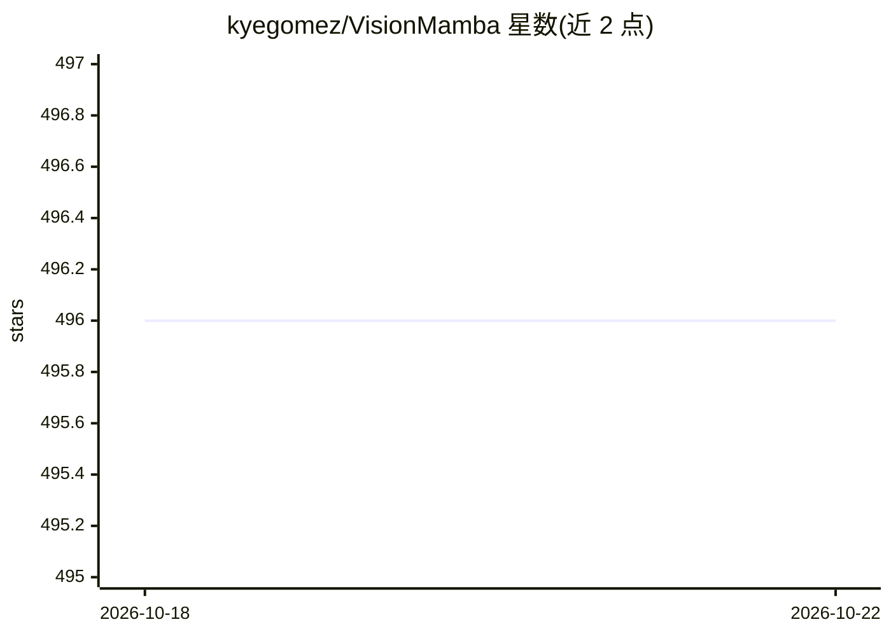

# kyegomez/VisionMamba

⭐ 496 · Python · MIT · 推送 2026-10-14 · [GitHub](https://github.com/kyegomez/VisionMamba) · [官网](https://discord.gg/GYbXvDGevY) · 个人维护

**Vision Mamba 论文的 PyTorch 实现，双向状态空间视觉模型**

论文《Vision Mamba: Efficient Visual Representation Learning with Bidirectional State Space Model》的 PyTorch 实现，提供 Vim 模型类，可导入后随机初始化权重并提取图像特征，用于视觉表示学习研究。README 未附带预训练权重，训练脚本（ImageNet）与人脸识别变体列为待办事项。以 pip 包形式安装，MIT 许可，附论文引用条目。

## 筛选速览

| 维度 | 判定 | 备注 |
|---|---|---|
| AI 角色 | `ai-native` | 本体是模型或模型工具 |
| 许可风险 | `permissive` | MIT |
| 部署形态 | `library` | 以包/库形式分发 |
| 模型依赖 | — | README 未给出锁定关系 |
| 硬件要求 | — | 无带数字的原话,不猜 |
| 安装摩擦 | `low` | 无编译、无系统依赖或容器化 |
| 成熟度 | — | 结构信号不足 |

## 能力要点

- Vim 模型类的 PyTorch 实现
- 支持随机初始化权重并前向提取图像特征
- pip install vision-mamba 安装

## 适用场景

- 复现或研究 Vision Mamba 双向 SSM 视觉模型
- 在自建训练流程中使用 Vim 架构提取视觉特征

## 场景标签

 · 领域:计算机视觉/深度学习

## 证据(README 行号)

> L4: Implementation of Vision Mamba from the paper: "Vision Mamba: Efficient Visual Representation Learning with Bidirect
> L16: import torch

## 星数曲线

2026-10-18 496 → 2026-10-22 496（+0）

---
*卡片 v1 · prompt 1.4 · 生成 2026-10-21 · 置信度 high · 依据 README sha `f1c8bd674e3c` · [字段定义](../../DATASET.md)*
