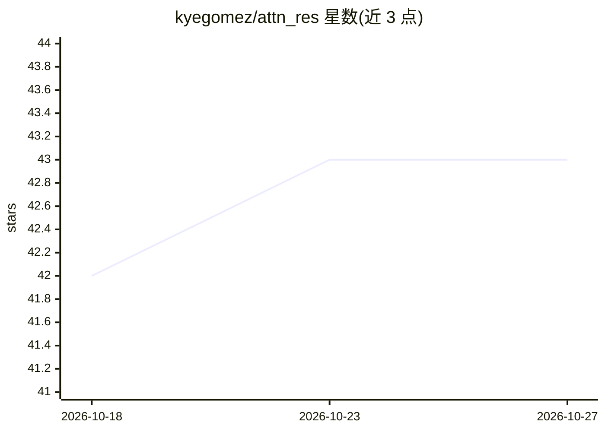

# kyegomez/attn_res

⭐ 43 · Python · Apache-2.0 · 推送 2026-03-16 · [GitHub](https://github.com/kyegomez/attn_res) · [官网](https://discord.gg/EamjgSaEQf) · 个人维护

**Attention Residuals 论文的非官方 PyTorch 单文件实现，供研究使用**

对 Kimi Team（MoonshotAI, 2026）Attention Residuals 论文的独立复现：以学习式 softmax 加权的层间注意力替换固定加性残差，每层用零初始化伪查询与 RMSNorm 键归一化对先前层表示做可微检索。集成 GQA、SwiGLU、RoPE 组成 decoder-only transformer，提供 Full（O(L·B·T·d) 显存）与 Block（O(N·d)）两种模式及两阶段在线 softmax 合并推理。明确声明非官方实现，面向研究与教育用途，经 pip 安装并提供冒烟测试。

## 筛选速览

| 维度 | 判定 | 备注 |
|---|---|---|
| AI 角色 | `ai-native` | 本体是模型或模型工具 |
| 许可风险 | `permissive` | Apache-2.0 |
| 部署形态 | `library` | 以包/库形式分发 |
| 模型依赖 | — | README 未给出锁定关系 |
| 硬件要求 | — | 无带数字的原话,不猜 |
| 安装摩擦 | `low` | 无编译、无系统依赖或容器化 |
| 成熟度 | — | 结构信号不足 |

## 能力要点

- 单文件 PyTorch 复现 Attention Residuals 残差路由机制
- 提供 FULL 与 BLOCK 两种残差模式，BLOCK 将显存占用降至 O(N·d)
- 两阶段推理与 online softmax 合并，数值等价且免重建 logits
- 集成 GQA、SwiGLU FFN、RoPE，超参数经 TransformerConfig 暴露

## 适用场景

- 研究 transformer 层间残差连接的替代机制
- 在自己的 transformer 中以 AttnResOperator 作为层间路由组件
- 复现论文的 Block AttnRes 显存优化与两阶段推理方案

## 场景标签

 · 领域:深度学习/模型架构研究

## 证据(README 行号)

> L36: A clean, single-file PyTorch implementation of **Attention Residuals** (Kimi Team, MoonshotAI, 2026), integrated wi
> L118: **Attention Residuals** (Kimi Team, 2026) replaces this fixed aggregation with a learned, depth-wise attention ope

## 星数曲线

2026-10-18 42 → 2026-10-27 43（+1）

---
*卡片 v1 · prompt 1.4 · 生成 2026-10-25 · 置信度 high · 依据 README sha `b504a11b4294` · [字段定义](../../DATASET.md)*
