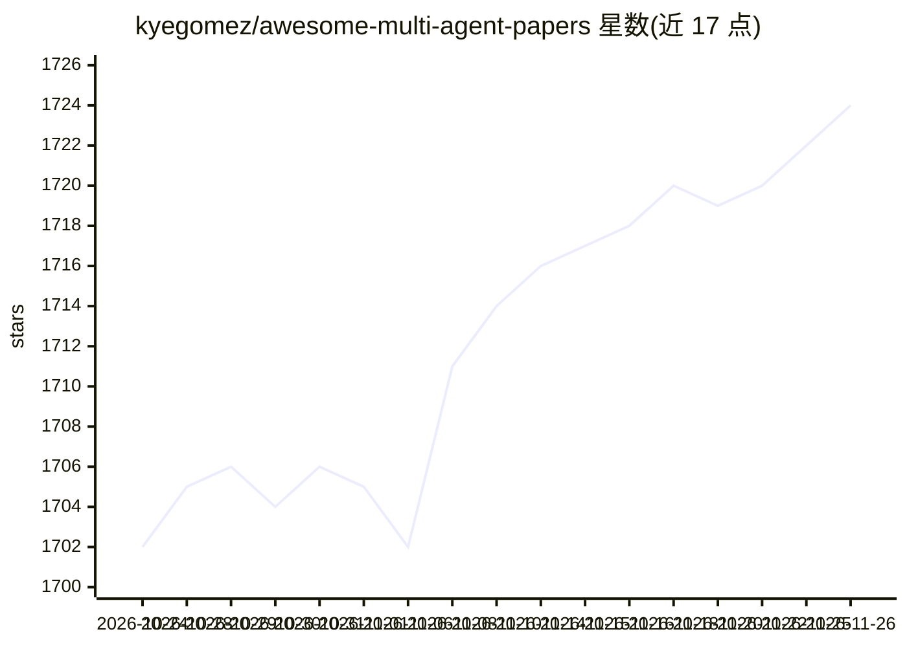

# kyegomez/awesome-multi-agent-papers

⭐ 1,724 · TeX · NOASSERTION · 推送 2026-11-25 · [GitHub](https://github.com/kyegomez/awesome-multi-agent-papers) · [官网](https://swarms.ai) · 组织维护

**面向多智能体研究者的论文聚合清单**

由 Swarms 团队维护的多智能体研究论文清单，以 [标题][链接] 格式收录论文，按多智能体协作与系统设计、框架与基准、应用方向（软件工程、医疗、数据与机器学习、安全、多模态）分类组织。清单与 Swarms 框架、官网及 Discord 社区关联，不含安装步骤或运行代码，仅作论文导航用途。

## 筛选速览

| 维度 | 判定 | 备注 |
|---|---|---|
| AI 角色 | `ai-knowledge` | 知识聚合/清单类 |
| 许可风险 | `none` | NOASSERTION |
| 部署形态 | `None` |  |
| 模型依赖 | — | README 未给出锁定关系 |
| 硬件要求 | — | 无带数字的原话,不猜 |
| 安装摩擦 | `low` | 无编译、无系统依赖或容器化 |
| 成熟度 | — | 结构信号不足 |

## 能力要点

- 按协作机制、框架基准、应用领域分类组织论文条目
- 覆盖软件工程、医疗、数据科学、安全、多模态等应用方向
- 由 Swarms 团队维护并附 Discord 社区入口

## 适用场景

- 查找多智能体系统方向的论文阅读起点
- 按应用领域检索相关多智能体研究
- 跟踪多智能体框架与基准的论文脉络

## 场景标签

`精选清单` `科研工具` · 领域:学习与行业

## 证据(README 行号)

> L37:  This is an awesome list of the best multi-agent research papers, compiled by the Swarms Team. Our mission at Swarm
> L39: ## Format
> L43: ## Multi-Agent Collaboration & System Design

## 星数曲线

2026-10-24 1,702 → 2026-11-26 1,724（+22）

---
*卡片 v1 · prompt 1.4 · 生成 2026-11-23 · 置信度 high · 依据 README sha `ac584318a44b` · [字段定义](../../DATASET.md)*
