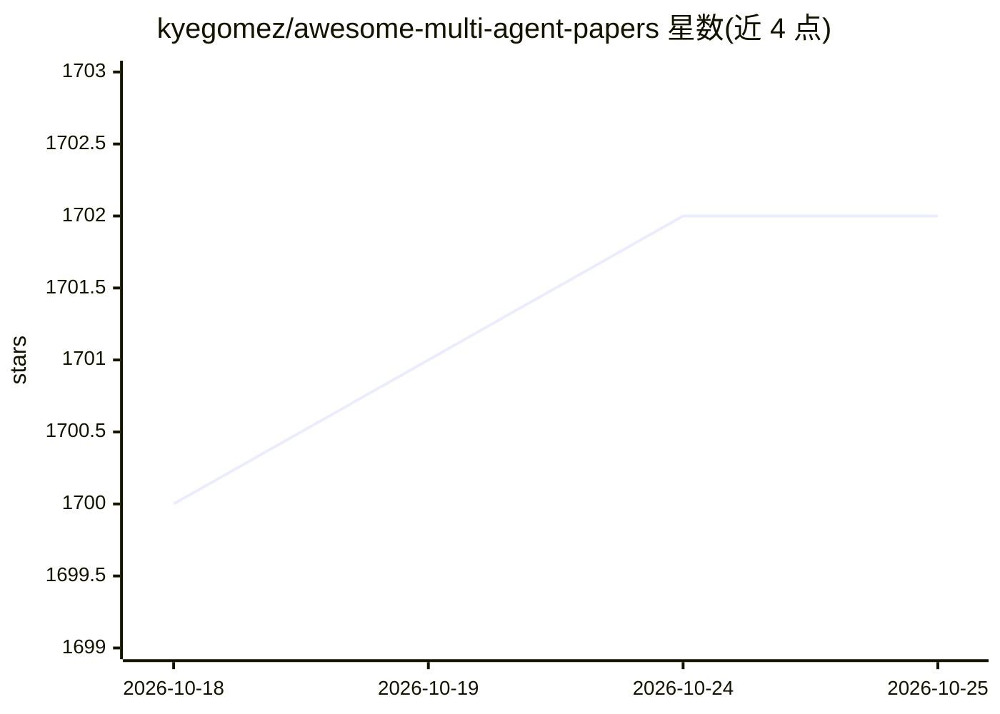

# kyegomez/awesome-multi-agent-papers

⭐ 1,702 · TeX · NOASSERTION · 推送 2026-10-23 · [GitHub](https://github.com/kyegomez/awesome-multi-agent-papers) · [官网](https://discord.gg/3keGBK9Pvr) · 组织维护

**多智能体（Multi-Agent）研究论文策展清单**

由 Swarms 团队维护的 awesome list，汇编多智能体系统研究论文，按主题分类：协作与系统设计、框架与基准、以及软件工程、医疗、数据与 ML、安全、多模态等应用领域。条目格式为论文名加链接，覆盖协作机制、测试时扩展、通信协议、基准评测等方向。页面顶部链接 Swarms 框架、官网与 Discord。仓库本身为静态清单，不含可安装代码。

## 筛选速览

| 维度 | 判定 | 备注 |
|---|---|---|
| AI 角色 | `ai-knowledge` | 知识聚合/清单类 |
| 许可风险 | `none` | NOASSERTION |
| 部署形态 | `None` |  |
| 模型依赖 | — | README 未给出锁定关系 |
| 硬件要求 | — | 无带数字的原话,不猜 |
| 安装摩擦 | `low` | 无编译、无系统依赖或容器化 |
| 成熟度 | — | 结构信号不足 |

## 能力要点

- 按主题分区的论文清单：协作与系统设计、框架与基准、应用领域
- 应用领域细分软件工程、医疗、数据与 ML、安全、多模态等
- 由 Swarms 团队维护并关联 Swarms 框架与社区

## 适用场景

- 查找多智能体 LLM 系统的研究论文
- 按应用领域（软件工程/医疗/安全等）检索相关工作
- 了解多智能体框架与基准的论文分布

## 场景标签

`精选清单` `多智能体` · 领域:Agent 开发

## 证据(README 行号)

> L35:  This is an awesome list of the best multi-agent research papers, compiled by the Swarms Team. Our mission at Swarm
> L41: ## Multi-Agent Collaboration & System Design

## 星数曲线

2026-10-18 1,700 → 2026-10-25 1,702（+2）

---
*卡片 v1 · prompt 1.4 · 生成 2026-10-21 · 置信度 high · 依据 README sha `71092fb850c3` · [字段定义](../../DATASET.md)*
