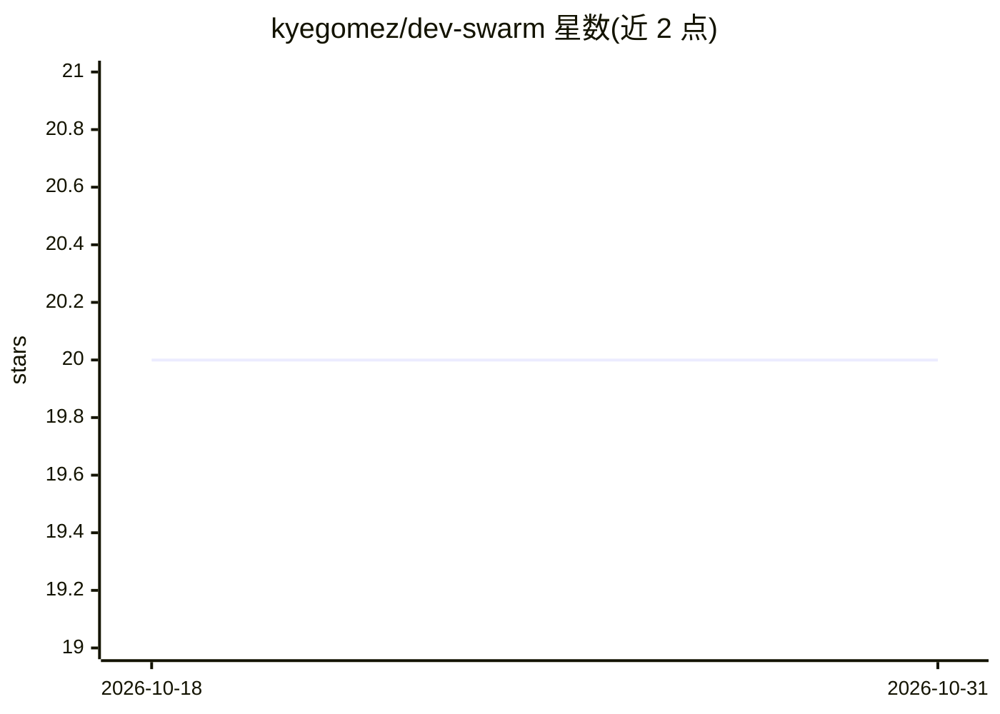

# kyegomez/dev-swarm

⭐ 20 · Python · MIT · 推送 2026-10-26 · [GitHub](https://github.com/kyegomez/dev-swarm) · [官网](https://github.com/kyegomez/swarms) · 个人维护

**协助测试、文档化与工程化代码的 LLM agent 集群**

dev-swarm 是一个 Python 包（pip install dev-swarm），提供名为 DevSwarm 的多智能体集群，用于对代码执行测试、文档编写与生产化（productionize）相关的任务。使用方式为从 dev_swarm 模块导入 DevSwarm 类并按示例调用。README 仅含安装与一段示例用法，未说明具体支持的模型提供方、底层框架或运行限制，信息量较少。

## 筛选速览

| 维度 | 判定 | 备注 |
|---|---|---|
| AI 角色 | `ai-ecosystem` | LLM/agent 周边工具 |
| 许可风险 | `permissive` | MIT |
| 部署形态 | `library` | 以包/库形式分发 |
| 模型依赖 | — | README 未给出锁定关系 |
| 硬件要求 | — | 无带数字的原话,不猜 |
| 安装摩擦 | `low` | 无编译、无系统依赖或容器化 |
| 成熟度 | — | 结构信号不足 |

## 能力要点

- 提供 DevSwarm 类的 Python API，用于编排 LLM agent 集群
- 面向代码测试、文档编写与生产化任务
- 通过 pip 安装

## 适用场景

- 用 agent 集群为项目生成测试
- 让 agent 编写或补全代码文档
- 辅助将代码推向生产就绪状态

## 场景标签

`多智能体` `编码 Agent` · 领域:Agent 开发

## 证据(README 行号)

> L3: # Dev Swarm
> L13: ````python
> L14: from dev_swarm import DevSwarm

## 星数曲线



2026-10-18 20 → 2026-10-31 20（+0）


---
*卡片 v1 · prompt 1.4 · 生成 2026-10-28 · 置信度 low · 依据 README sha `15ff96f9c382` · [字段定义](../../DATASET.md)*
