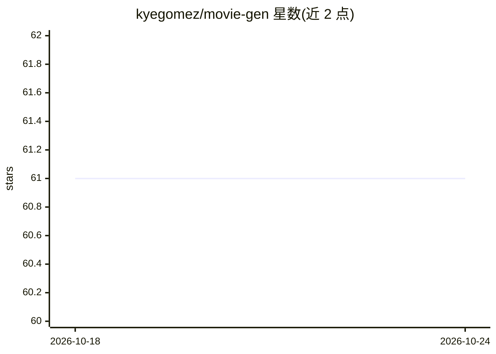

# kyegomez/movie-gen

⭐ 61 · Python · MIT · 推送 2026-10-19 · [GitHub](https://github.com/kyegomez/movie-gen) · [官网](https://discord.com/servers/agora-999382051935506503) · 个人维护

**Meta Movie Gen 论文的开源社区实现：视频/音频生成模型**

对论文《Movie Gen: A Cast of Media Foundation Models》的开源社区实现，目标任务包括文生视频、视频个性化、基于指令的视频编辑、视频转音频与文生音频。README 描述了论文中三个规模的模型（5B/15B/30B 参数，最长 73K 视频上下文，16fps），并给出 TemporalAutoencoder 等组件的 Python 用法与 evaluate.py 复现评估脚本。通过 git clone 源码加 pip 安装依赖运行，MIT 许可。注意 README 大量内容转述 Meta 论文成果，仓库本身为进行中的社区实现，可用组件范围以代码为准。

## 筛选速览

| 维度 | 判定 | 备注 |
|---|---|---|
| AI 角色 | `ai-native` | 本体是模型或模型工具 |
| 许可风险 | `permissive` | MIT |
| 部署形态 | `library` | 以包/库形式分发 |
| 模型依赖 | — | README 未给出锁定关系 |
| 硬件要求 | — | 无带数字的原话,不猜 |
| 安装摩擦 | `low` | 无编译、无系统依赖或容器化 |
| 成熟度 | — | 结构信号不足 |

## 能力要点

- 文生视频、视频编辑、视频转音频与文生音频任务实现
- TemporalAutoencoder (TAE) 等组件的 Python API
- evaluate.py 复现论文评估指标（如 text-to-video）

## 适用场景

- 研究生成式视频/音频基础模型论文的社区实现
- 运行文生视频与视频个性化任务
- 复现论文的评估基准

## 场景标签

`视频生成` · 领域:内容生成

## 证据(README 行号)

> L7: **Movie Gen** is a collection of cutting-edge foundation models developed by the Movie Gen team at **Meta1**. These 
> L9: - **Text-to-video synthesis**
> L12: - **Video-to-audio generation**

## 星数曲线

2026-10-18 61 → 2026-10-24 61（+0）

---
*卡片 v1 · prompt 1.4 · 生成 2026-10-24 · 置信度 low · 依据 README sha `f152f9c2dea4` · [字段定义](../../DATASET.md)*
