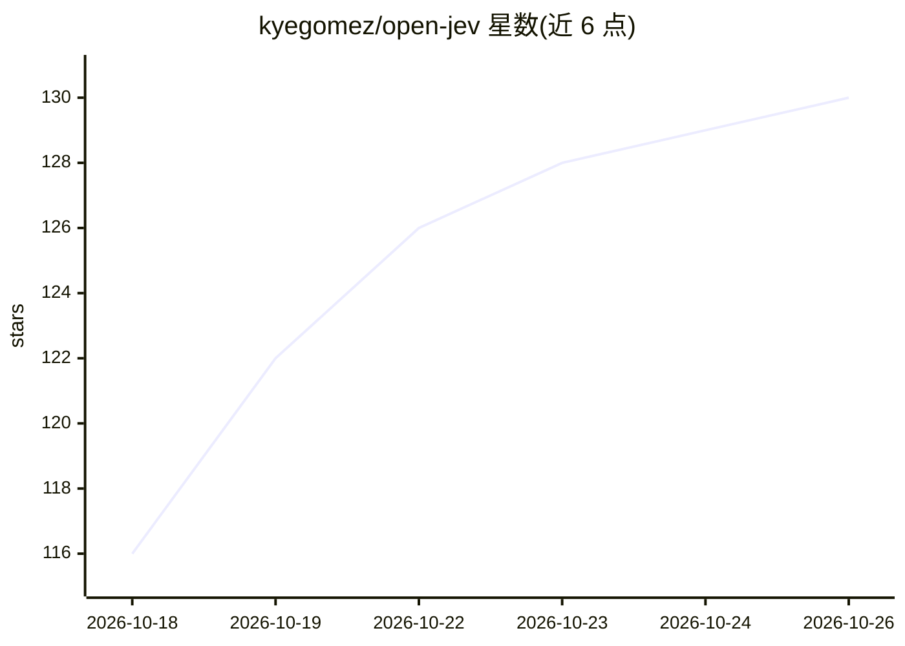

# kyegomez/open-jev

⭐ 130 · Python · Apache-2.0 · 推送 2026-09-21 · [GitHub](https://github.com/kyegomez/open-jev) · [官网](https://discord.gg/3keGBK9Pvr) · 个人维护

**Jev 概念的 PyTorch 复现研究实现（随机权重）**

对 TypeSafe AI 的 Jev 'System One Model' 思想的开源复现：非自回归生成文本，而是用双向 transformer 一次性编码嵌套程序状态，通过小型类型化读出头（Noul/Choice/Score）以单次并行前向输出受类型约束的概率决策，含证据置信头与 RLCDLoss 训练目标。面向研究者与开发者；当前为随机权重的未训练研究实现，哈希分词器仅适合运行架构不适合训练，不声称复现原模型结果。

## 筛选速览

| 维度 | 判定 | 备注 |
|---|---|---|
| AI 角色 | `ai-native` | 本体是模型或模型工具 |
| 许可风险 | `permissive` | Apache-2.0 |
| 部署形态 | `library` | 以包/库形式分发 |
| 模型依赖 | — | README 未给出锁定关系 |
| 硬件要求 | — | 无带数字的原话,不猜 |
| 安装摩擦 | `low` | 无编译、无系统依赖或容器化 |
| 成熟度 | `idea` | |

## 能力要点

- 双向状态编码器 + 共享可缓存状态表示，问题槽位交叉注意
- 类型化读出头：Noul 真值概率、Choice 运行时选项 softmax、Score 序数分布
- 证据置信头将认知置信与类别概率分开建模
- RLCDLoss 组合软目标 NLL、Brier、一致性、置信与 ECE 项

## 适用场景

- 研究 System One Model 架构的类型化输出机制
- 作为类型化概率决策头的实验代码基座
- 复现并扩展作者对 Jev 公开资料的架构推断

## 场景标签

`模型训练` `科研工具` · 领域:学习与行业

## 证据(README 行号)

> L17: Instead of generating text one token at a time, this implementation encodes the
> L33: - A bidirectional transformer encodes nested state without a causal mask

## 星数曲线

2026-10-18 116 → 2026-10-26 130（+14）

---
*卡片 v1 · prompt 1.4 · 生成 2026-10-23 · 置信度 mid · 依据 README sha `2aeb92f8ef02` · [字段定义](../../DATASET.md)*
