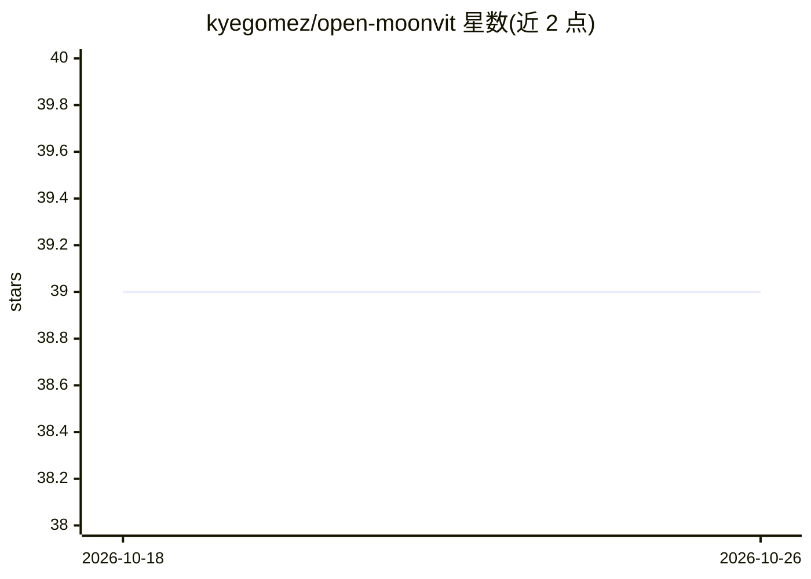

# kyegomez/open-moonvit

⭐ 39 · Python · Apache-2.0 · 推送 2026-04-25 · [GitHub](https://github.com/kyegomez/open-moonvit) · [官网](https://discord.gg/3keGBK9Pvr) · 个人维护

**MoonViT 原生分辨率视觉编码器的单文件 PyTorch 实现**

对 Kimi-VL 中的原生分辨率视觉编码器 MoonViT 的单文件 PyTorch 复现，面向研究者与开发者。支持任意 (H, W) 尺寸图像输入，采用 packing 而非 padding、cu_seqlens 变长注意力隔离图像、绝对位置嵌入与 2D RoPE 双重位置编码；FlashAttention 为可选依赖，缺失时回退到 SDPA（CPU/MPS/CUDA 均可运行）。附带 MLPProjector（2×2 pixel-shuffle + 两层 MLP）将视觉特征投影到 LLM 隐空间，供多模态模型组合使用。以 PyPI 包与源码两种方式安装。

## 筛选速览

| 维度 | 判定 | 备注 |
|---|---|---|
| AI 角色 | `ai-native` | 本体是模型或模型工具 |
| 许可风险 | `permissive` | Apache-2.0 |
| 部署形态 | `library` | 以包/库形式分发 |
| 模型依赖 | — | README 未给出锁定关系 |
| 硬件要求 | `cpu-ok` | |
| 安装摩擦 | `low` | 无编译、无系统依赖或容器化 |
| 成熟度 | — | 结构信号不足 |

## 能力要点

- 单文件实现 MoonViT 原生分辨率视觉编码器
- packing 策略打包变尺寸图像，批次内零 padding token
- 绝对位置嵌入 + 2D RoPE 双重位置编码
- MLPProjector 经 pixel-shuffle 投影到 LLM 隐空间，token 数 ÷4

## 适用场景

- 为多模态 LLM 提供可处理任意尺寸图像的视觉编码器
- 研究 NaViT 式 packing 与变长注意力在视觉编码中的应用
- 在没有 FlashAttention 的 CPU/MPS 环境运行原生分辨率 ViT

## 场景标签

 · 领域:计算机视觉/多模态模型

## 证据(README 行号)

> L26: This is an ultra-simple, single-file PyTorch implementation of MoonViT, the native-resolution vision encoder from K
> L42: FlashAttention is optional. If `flash_attn` is importable and you're on CUDA, the var-length kernel is used automat
> L80: 4. **The projector lives outside the encoder.** Pixel shuffle is a 2×2 space-to-depth: four tokens become one, chan

## 星数曲线

2026-10-18 39 → 2026-10-26 39（+0）

---
*卡片 v1 · prompt 1.4 · 生成 2026-10-25 · 置信度 high · 依据 README sha `f4a5374e2b37` · [字段定义](../../DATASET.md)*
