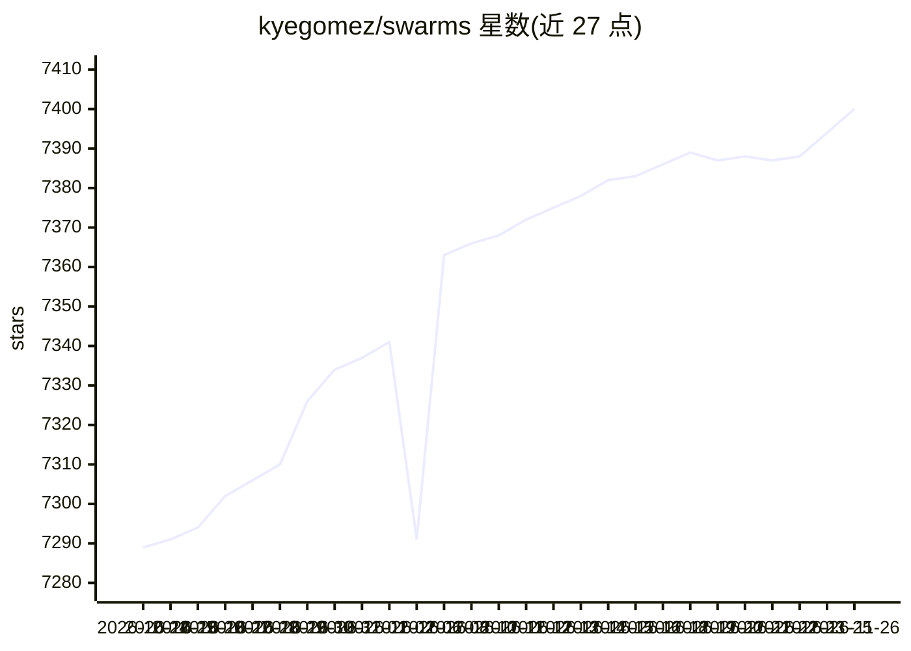

# kyegomez/swarms

⭐ 7,400 · Python · Apache-2.0 · 推送 2026-11-25 · [GitHub](https://github.com/kyegomez/swarms) · [官网](https://docs.swarms.world) · 个人维护 · 中文 README

**面向企业的多智能体编排框架：构建、部署与扩展 swarm 系统**

Swarms 是一个 Python 多智能体编排框架，提供 Agent（LLM+工具+内存）基础构件与多种预置多智能体架构：SequentialWorkflow、ConcurrentWorkflow、GraphWorkflow（DAG）、MixtureOfAgents、GroupChat、HierarchicalSwarm、HeavySwarm 等，共 60+ 种结构。支持 MCP 集成（接入 MCP 服务器取工具，或经 MCPDeployer 将 agent 反向暴露为带鉴权的 MCP server）、AutoSwarmBuilder 按任务描述自动生成 agent 团队、自定义 Social Algorithms。通过 pip 或 Docker 分发，运行需配置各家模型 API key。

## 筛选速览

| 维度 | 判定 | 备注 |
|---|---|---|
| AI 角色 | `ai-ecosystem` | LLM/agent 周边工具 |
| 许可风险 | `permissive` | Apache-2.0 |
| 部署形态 | `self-host` | docker 或自建部署 |
| 模型依赖 | — | README 未给出锁定关系 |
| 硬件要求 | — | 无带数字的原话,不猜 |
| 安装摩擦 | `low` | 无编译、无系统依赖或容器化 |
| 成熟度 | — | 结构信号不足 |

## 能力要点

- 60+ 预置多智能体架构（顺序/并发/DAG/层级/群聊等）
- MCP 双向集成：接入 MCP 工具服务器，或用 MCPDeployer 将 agent 发布为 MCP server
- AutoSwarmBuilder 从任务描述自动生成 agent、提示词与工作流
- swarms[fast] 可选加速：LLM 网关与 rustworkx 图后端

## 适用场景

- 将研究、写作等多角色 agent 串成流水线生成报告
- 批量并行处理高吞吐任务（ConcurrentWorkflow）
- 用层级式 director/worker 结构做项目分解与任务分发
- 把已有 agent 发布为 MCP server 供其他系统调用

## 场景标签

`Agent 框架` `多智能体` · 领域:Agent 开发

## 证据(README 行号)

> L37: > Swarms, The Enterprise-Grade Production-Ready Multi-Agent Orchestration Framework
> L163: `swarms` provides a variety of powerful, pre-built multi-agent architectures enabling you to orchestrate agents in

## 星数曲线

2026-10-24 7,289 → 2026-11-26 7,400（+111）

---
*卡片 v1 · prompt 1.4 · 生成 2026-11-24 · 置信度 high · 依据 README sha `c50a2abb5944` · [字段定义](../../DATASET.md)*
