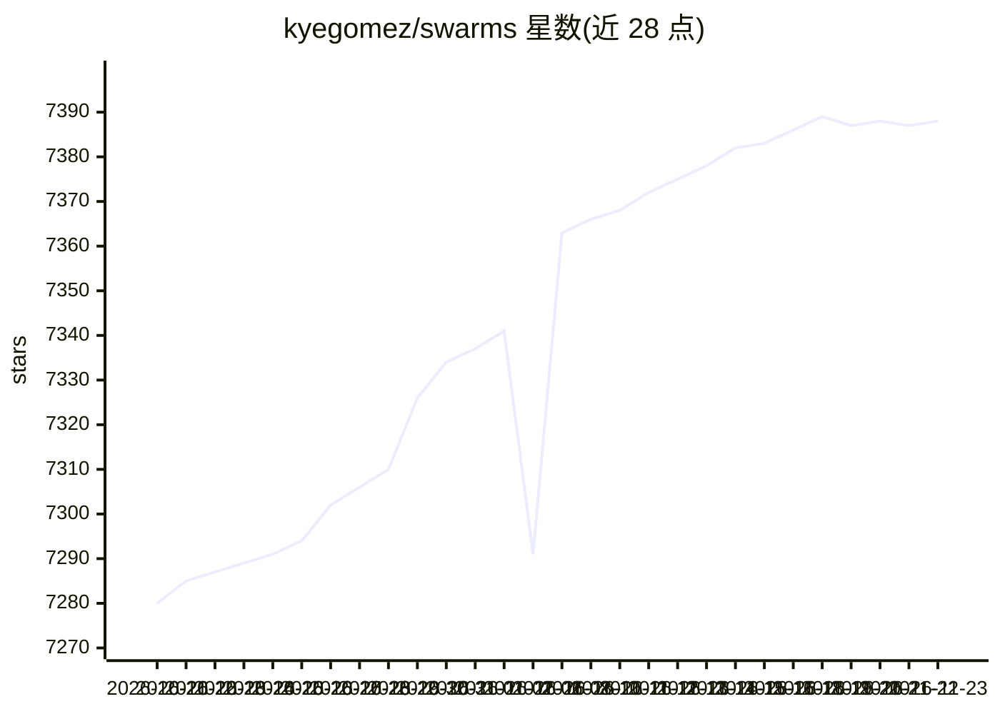

# kyegomez/swarms

⭐ 7,388 · Python · Apache-2.0 · 推送 2026-11-22 · [GitHub](https://github.com/kyegomez/swarms) · [官网](https://docs.swarms.world) · 个人维护 · 中文 README

**多智能体编排框架：构建、部署与扩展多 Agent 系统**

以 Python 库与 CLI 形式提供的多智能体编排框架，核心构件为 Agent（LLM + Tools + Memory）与多种预置编排结构，包括 SequentialWorkflow、ConcurrentWorkflow、AgentRearrange、GraphWorkflow、MixtureOfAgents、GroupChat、HierarchicalSwarm、HeavySwarm、SwarmRouter 等，README 称另有 60+ 种结构。支持 MCP 集成（接入外部 MCP 服务器工具，或通过 MCPDeployer 将任意 Agent/Swarm 部署为带鉴权的 MCP 服务器）。安装途径包括 pip、源码与官方 Docker 镜像，模型调用通过环境变量配置 API key。

## 筛选速览

| 维度 | 判定 | 备注 |
|---|---|---|
| AI 角色 | `ai-ecosystem` | LLM/agent 周边工具 |
| 许可风险 | `permissive` | Apache-2.0 |
| 部署形态 | `self-host` | docker 或自建部署 |
| 模型依赖 | — | README 未给出锁定关系 |
| 硬件要求 | — | 无带数字的原话,不猜 |
| 安装摩擦 | `low` | 无编译、无系统依赖或容器化 |
| 成熟度 | — | 结构信号不足 |

## 能力要点

- 提供 Sequential/Concurrent/Graph/MoA/GroupChat/Hierarchical 等多种预置编排结构
- 支持 MCP 双向集成：消费外部 MCP 工具，或将 Agent/Swarm 部署为 MCP 服务器
- max_loops="auto" 让 Agent 自主决定任务完成时机
- 官方 Docker 镜像覆盖 linux/amd64 与 linux/arm64

## 适用场景

- 将研究、写作等任务编排为多 Agent 流水线
- 把已有 Agent 通过 MCPDeployer 暴露为 MCP 服务供其他 Agent 调用
- 构建需要多角色协作决策的对话式群聊系统
- 用 AutoSwarmBuilder 从任务描述快速生成 Agent 团队原型

## 场景标签

`Agent 框架` `多智能体` · 领域:Agent 开发

## 证据(README 行号)

> L39: Build, deploy, and scale high-performance multi-agent systems with Swarms Python, a fast, flexible, and optimized a
> L163: `swarms` provides a variety of powerful, pre-built multi-agent architectures enabling you to orchestrate agents in

## 星数曲线

2026-10-21 7,280 → 2026-11-23 7,388（+108）

---
*卡片 v1 · prompt 1.4 · 生成 2026-11-22 · 置信度 high · 依据 README sha `b434b9da1d9a` · [字段定义](../../DATASET.md)*
