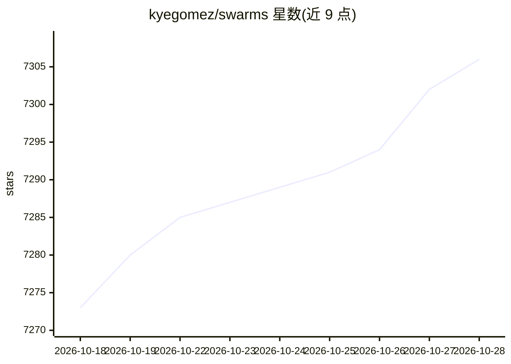

# kyegomez/swarms

⭐ 7,310 · Python · Apache-2.0 · 推送 2026-10-28 · [GitHub](https://github.com/kyegomez/swarms) · [官网](https://docs.swarms.world) · 个人维护 · 中文 README

**面向企业的 Python 多智能体编排框架**

Swarms 是一个用于构建、部署和扩展多智能体系统的 Python 框架，面向生产环境的 agent 应用开发者。核心机制包括：Agent（LLM+工具+记忆）为基本单元；提供顺序、并发、DAG 图、层次化等 60+ 种预置多智能体架构，以及统一入口 SwarmRouter 和按任务描述自动生成智能体团队的 AutoSwarmBuilder；支持 MCP 协议（作为客户端接入外部工具，也可通过 MCPDeployer 将 agent 反向暴露为 MCP 服务器）。安装支持 pip、源码与官方 Docker 镜像，可选 swarms[fast] 加速模型调用与图执行。需配置模型 API key 等环境变量。

## 筛选速览

| 维度 | 判定 | 备注 |
|---|---|---|
| AI 角色 | `ai-ecosystem` | LLM/agent 周边工具 |
| 许可风险 | `permissive` | Apache-2.0 |
| 部署形态 | `self-host` | docker 或自建部署 |
| 模型依赖 | — | README 未给出锁定关系 |
| 硬件要求 | — | 无带数字的原话,不猜 |
| 安装摩擦 | `low` | 无编译、无系统依赖或容器化 |
| 成熟度 | — | 结构信号不足 |

## 能力要点

- 60+ 种预置多智能体架构（顺序/并发/DAG/MoA/GroupChat/层次化等）
- MCP 双向集成：agent 可消费 MCP 服务器工具，也可经 MCPDeployer 暴露为 MCP 服务器
- max_loops=auto 模式让 agent 自主决定任务完成时机
- 可选 swarms[fast]：RouteHub LLM 网关与 Rust 编写的 rustworkx 图后端

## 适用场景

- 编排研究、分析、写作等多步骤多智能体工作流
- 构建需要 fan-out/fan-in 依赖关系的 DAG 任务流水线
- 将智能体作为 MCP 服务提供给其他 agent 或 MCP 宿主调用
- 通过 SwarmRouter 在多种协作策略间切换复用同一组 agent

## 场景标签

`Agent 框架` `多智能体` · 领域:Agent 开发

## 证据(README 行号)

> L39: Build, deploy, and scale high-performance multi-agent systems with Swarms Python, a fast, flexible, and optimized a
> L181: `swarms` provides a variety of powerful, pre-built multi-agent architectures enabling you to orchestrate agents in
> L196: Learn more about all of the 60+ Multi-Agent Structures we have available here

## 星数曲线

2026-10-18 7,273 → 2026-10-28 7,306（+33）

---
*卡片 v1 · prompt 1.4 · 生成 2026-10-20 · 置信度 high · 依据 README sha `83d833db96de` · [字段定义](../../DATASET.md)*
