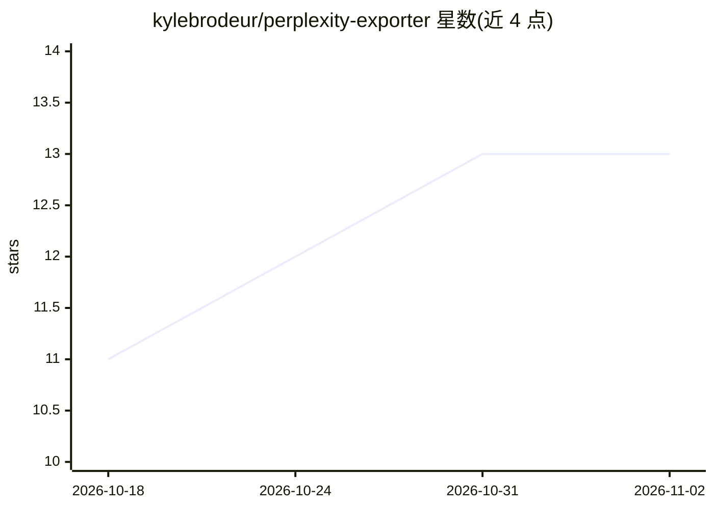

# kylebrodeur/perplexity-exporter

⭐ 13 · TypeScript · MIT · 推送 2026-10-23 · [GitHub](https://github.com/kylebrodeur/perplexity-exporter) · [官网](https://www.npmjs.com/package/perplexity-exporter) · 个人维护

**将 Perplexity.ai 全部对话线程导出为 JSON 的 CLI 工具**

基于 Playwright 的 TypeScript 命令行工具，面向拥有 Perplexity.ai 账号的用户：打开持久化 Chromium 窗口保存登录会话，自动滚动 Library 加载全部线程，通过浏览器 Cookie 调用 Perplexity API 获取每个线程的完整来回对话及来源，写入带时间戳的 JSON 文件，重复运行不覆盖旧导出。要求 Node.js 24+，首跑自动下载 Chromium（约 150 MB），请求间加入约 350ms 延迟以限速，超大库（1000+ 线程）可能耗时数分钟。

## 筛选速览

| 维度 | 判定 | 备注 |
|---|---|---|
| AI 角色 | `ai-ecosystem` | LLM/agent 周边工具 |
| 许可风险 | `permissive` | MIT |
| 部署形态 | `library` | 以包/库形式分发 |
| 模型依赖 | — | README 未给出锁定关系 |
| 硬件要求 | — | 无带数字的原话,不猜 |
| 安装摩擦 | `low` | 无编译、无系统依赖或容器化 |
| 成熟度 | — | 结构信号不足 |

## 能力要点

- 自动滚动处理无限滚动分页，导出全部对话线程
- 持久化浏览器会话，登录一次后续运行免登录
- 保留完整对话来回记录及来源，输出带时间戳 JSON
- 通过 npx 免安装直接运行

## 适用场景

- 备份我在 Perplexity.ai 的全部对话历史
- 将 Perplexity 对话数据迁移或离线归档为 JSON
- 批量留存带来源引用的问答记录

## 场景标签

`网页抓取` · 领域:效率与自动化

## 证据(README 行号)

> L7: Export all of your Perplexity.ai conversation threads to JSON, preserving the full back-and-forth conversation histo
> L13: 3. Fetches full conversation details for each thread via the Perplexity API (using your browser cookies)

## 星数曲线

2026-10-18 11 → 2026-11-02 13（+2）

---
*卡片 v1 · prompt 1.4 · 生成 2026-10-31 · 置信度 high · 依据 README sha `f0702e79f604` · [字段定义](../../DATASET.md)*
