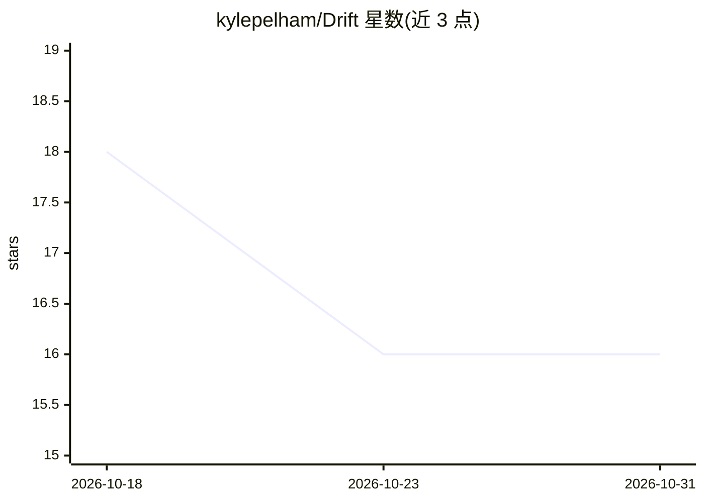

# kylepelham/Drift

⭐ 16 · TypeScript · MIT · 推送 2026-10-30 · [GitHub](https://github.com/kylepelham/Drift) · [官网](https://driftagent.dev) · 个人维护

**Windows 桌面 AI 编码代理：Rust 引擎管理多模型编码会话**

面向 Windows x64 的桌面编码代理应用，自带用 Rust 编写并链入应用的引擎，单进程负责代理循环、提供商、工具、MCP 服务器、权限、项目导航与持久线程历史。支持连接 Anthropic、OpenAI、xAI、Google、Vertex、Bedrock、Z.ai、OpenRouter、LM Studio、Ollama 等提供商。功能含上下文分叉、每步撤销、MCP 管理与 OAuth 登录、语言服务器错误回传，可从 opencode 一次性导入数据。以单个安装包分发，不含付费模型访问。

## 筛选速览

| 维度 | 判定 | 备注 |
|---|---|---|
| AI 角色 | `ai-native` | 本体是模型或模型工具 |
| 许可风险 | `permissive` | MIT |
| 部署形态 | `None` |  |
| 模型依赖 | local-ok | 支持本地模型 |
| 硬件要求 | — | 无带数字的原话,不猜 |
| 安装摩擦 | `low` | 无编译、无系统依赖或容器化 |
| 成熟度 | — | 结构信号不足 |

## 能力要点

- 自带 Rust 引擎，单进程处理代理循环/提供商/MCP/权限/线程历史
- 支持 10+ 模型提供商与任意 OpenAI 兼容服务器
- 上下文分叉、undo/redo、语言服务器编辑后错误回传
- 可选局域网远程访问（HTTPS 网关 + 一次性配对码），默认关闭

## 适用场景

- 在 Windows 桌面用 AI 代理进行日常编码与多线程会话管理
- 通过 MCP 服务器扩展代理可用的工具
- 从 opencode 迁移会话、配置与技能

## 场景标签

`编码 Agent` · 领域:编码与开发

## 证据(README 行号)

> L18: Drift is a desktop coding agent with its own engine, written in Rust and linked into the app.
> L36: |**Provider flexibility**|Connect Anthropic and OpenAI (keys, or your Claude and ChatGPT subscriptions), xAI (Super

## 星数曲线

2026-10-18 18 → 2026-10-31 16（-2）

---
*卡片 v1 · prompt 1.4 · 生成 2026-10-30 · 置信度 high · 依据 README sha `b5def48c345a` · [字段定义](../../DATASET.md)*
