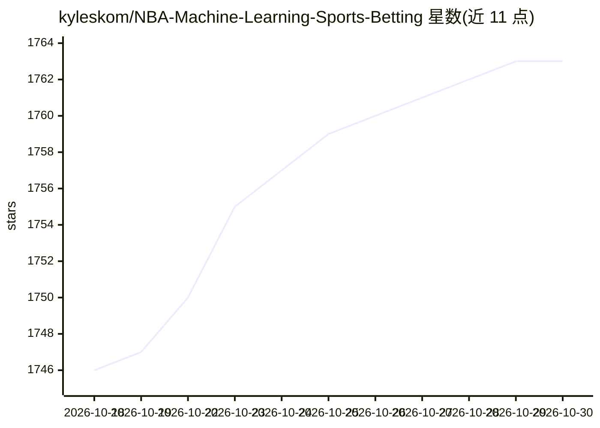

# kyleskom/NBA-Machine-Learning-Sports-Betting

⭐ 1,763 · Python · 推送 2026-09-12 · [GitHub](https://github.com/kyleskom/NBA-Machine-Learning-Sports-Betting) · 个人维护

**用机器学习预测 NBA 比赛胜负与大小分的投注分析工具**

从 NBA 数据端点抓取 2007-08 赛季至今的球队统计，从 SBR 抓取博彩公司赔率与比分，合并构建对阵特征，训练 XGBoost 与神经网络模型输出胜负概率与大小分预测，并计算期望值与可选的 Kelly 准则仓位。提供 main.py 命令行入口和 Flask 网页浏览结果，支持 7 家博彩公司赔率接入或手动输入。限制：神经网络训练脚本为硬编码路径的旧版本。

## 筛选速览

| 维度 | 判定 | 备注 |
|---|---|---|
| AI 角色 | `ai-native` | 本体是模型或模型工具 |
| 许可风险 | `none` | — |
| 部署形态 | `library` | 以包/库形式分发 |
| 模型依赖 | — | README 未给出锁定关系 |
| 硬件要求 | — | 无带数字的原话,不猜 |
| 安装摩擦 | `low` | 无编译、无系统依赖或容器化 |
| 成熟度 | — | 结构信号不足 |

## 能力要点

- XGBoost 与神经网络两种模型预测胜负盘与大小分
- 期望值计算与可选 Kelly 准则仓位建议
- 支持 7 家博彩公司赔率自动抓取或手动输入
- Flask 网页应用浏览预测结果

## 适用场景

- 每天运行脚本获取当日 NBA 比赛预测与期望值
- 回填历史数据与赔率以更新训练集
- 自行训练和调整胜负/大小分预测模型

## 场景标签

`数据分析` · 领域:效率与自动化

## 证据(README 行号)

> L4: This project predicts NBA game winners and totals (over/under) using team stats and sportsbook odds. It pulls team d
> L7: - Moneyline and totals predictions (XGBoost and Neural Net models).

## 星数曲线

2026-10-18 1,746 → 2026-10-30 1,763（+17）

---
*卡片 v1 · prompt 1.4 · 生成 2026-10-21 · 置信度 mid · 依据 README sha `65558ab15e5d` · [字段定义](../../DATASET.md)*
