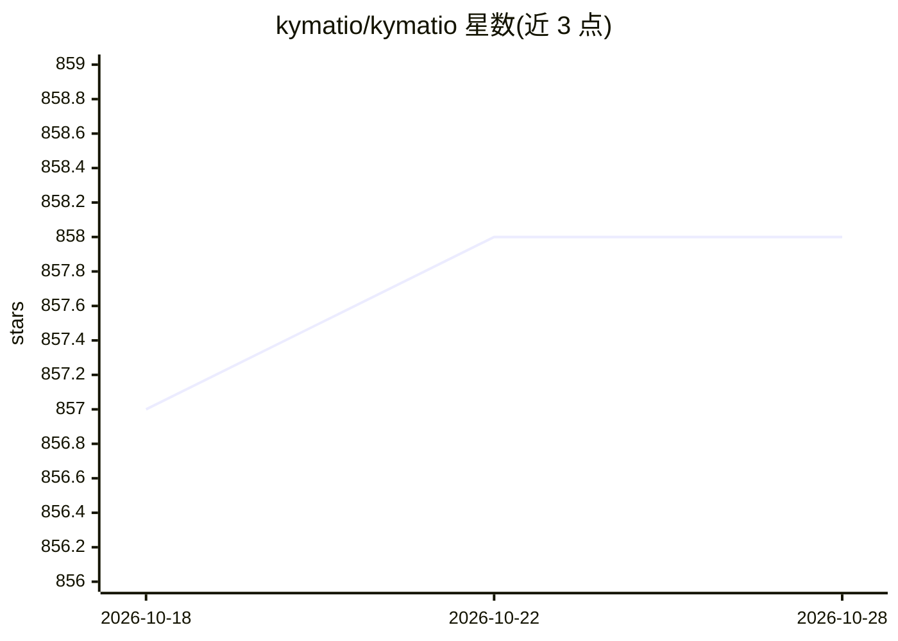

# kymatio/kymatio

⭐ 858 · Python · BSD-3-Clause · 推送 2026-06-09 · [GitHub](https://github.com/kymatio/kymatio) · [官网](https://kymat.io) · 组织维护

**Python 小波散射变换库：1/2/3D 小波，CPU/GPU 运行**

Kymatio 是小波散射变换的 Python 实现，提供 1D/2D/3D 小波散射系数提取，滤波器固定为小波而非学习得到。它整合多个既有小波散射包的开发者，通过 frontend/backend 架构提供八个组合：NumPy、scikit-learn（CPU），PyTorch、TensorFlow、Keras、Jax（CPU 和 GPU），并支持 skcuda 优化后端。散射系数可反向传播梯度，接入端到端可训练的深度学习流水线。依赖 Python>=3.7 与 SciPy，通过 pip 安装，官方支持 Linux 与 macOS。

## 筛选速览

| 维度 | 判定 | 备注 |
|---|---|---|
| AI 角色 | `ai-native` | 本体是模型或模型工具 |
| 许可风险 | `permissive` | BSD-3-Clause |
| 部署形态 | `library` | 以包/库形式分发 |
| 模型依赖 | — | README 未给出锁定关系 |
| 硬件要求 | — | 无带数字的原话,不猜 |
| 安装摩擦 | `medium` | 含编译或系统依赖之一 |
| 成熟度 | — | 结构信号不足 |

## 能力要点

- 支持 1D/2D/3D 小波散射变换，统一 API
- 八个 frontend-backend 组合，覆盖 PyTorch/TensorFlow/Keras/Jax/NumPy/scikit-learn
- torch 后端支持 skcuda 优化的 GPU 加速
- 散射系数可反向传播，可嵌入端到端可训练流水线

## 适用场景

- 在深度学习架构中集成小波散射作为特征提取层
- 信号处理与机器学习的大规模数值实验
- 需要平移不变信号表示的科研场景

## 场景标签

 · 领域:信号处理/机器学习库

## 证据(README 行号)

> L3: Kymatio is an implementation of the wavelet scattering transform in the Python programming language, suitable for la
> L4: Scattering transforms are translation-invariant signal representations implemented as convolutional networks whose f
> L14: * integrates wavelet scattering in a deep learning architecture, and

## 星数曲线

2026-10-18 857 → 2026-10-28 858（+1）

---
*卡片 v1 · prompt 1.4 · 生成 2026-10-21 · 置信度 high · 依据 README sha `f36e0dbd3263` · [字段定义](../../DATASET.md)*
