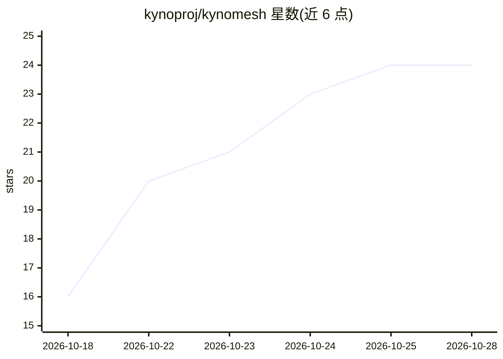

# kynoproj/kynomesh

⭐ 24 · Go · Apache-2.0 · 推送 2026-10-24 · [GitHub](https://github.com/kynoproj/kynomesh) · [官网](https://kyno.sh) · 组织维护

**Kubernetes 原生的分布式多智能体编排平台（Agent Mesh）**

面向在 Kubernetes 上运行多智能体系统的开发者：将一组协作的 AI agent 声明为单一自定义资源 AgentSet，由平台负责调度放置、对等发现与 A2A 流量。每个 agent 运行在独立 pod 组中，附带注入的 broker sidecar 管理通信与传输；内置基于流量和负载的自动扩缩容、零停机滚动更新、A2A 并发限流、外部 HTTP agent 混合接入与 AgentCard 漂移自动重载。agent 与语言无关，可用 Go、Python 等任意语言实现，并提供 Python 与 Go SDK。采用 Apache 2.0 许可证。

## 筛选速览

| 维度 | 判定 | 备注 |
|---|---|---|
| AI 角色 | `ai-ecosystem` | LLM/agent 周边工具 |
| 许可风险 | `permissive` | Apache-2.0 |
| 部署形态 | `None` |  |
| 模型依赖 | — | README 未给出锁定关系 |
| 硬件要求 | — | 无带数字的原话,不猜 |
| 安装摩擦 | `low` | 无编译、无系统依赖或容器化 |
| 成熟度 | — | 结构信号不足 |

## 能力要点

- AgentSet 自定义资源：以 Kubernetes API 统一声明与管理一组协作 agent
- 模式化对等发现（Supervisor/Handoff/Sequential），agent 无需自建服务发现逻辑
- 注入 broker sidecar 管理 A2A 通信与传输
- 内置自动扩缩容、零停机滚动更新与 A2A 并发限流

## 适用场景

- 在 Kubernetes 上运行 supervisor 协调 worker 的多 agent LLM 应用
- 搭建各阶段依次传递的顺序 agent 流水线
- 将不同语言编写的 agent 与外部 HTTP agent 统一在同一 Kubernetes API 后管理

## 场景标签

`多智能体` `Agent 框架` · 领域:Agent 开发

## 证据(README 行号)

> L9: Welcome to Kynomesh! A Kubernetes-native **Agent Mesh** platform for
> L10: orchestrating distributed multi-agent systems. Kynomesh lets you declare a group
> L11: of cooperating AI agents as a single Kubernetes resource and takes care of

## 星数曲线

2026-10-18 16 → 2026-10-28 24（+8）

---
*卡片 v1 · prompt 1.4 · 生成 2026-10-27 · 置信度 high · 依据 README sha `b53e8211e8ec` · [字段定义](../../DATASET.md)*
