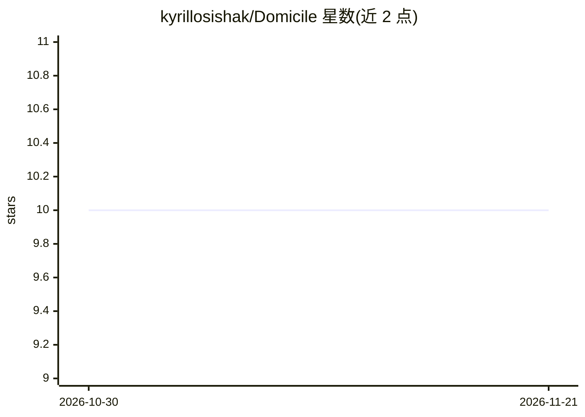

# kyrillosishak/Domicile

⭐ 10 · TypeScript · MIT · 推送 2026-06-24 · [GitHub](https://github.com/kyrillosishak/Domicile) · [官网](https://kyrillosishak.github.io/Domicile/) · 个人维护

**浏览器内全本地的向量库+RAG+本地 LLM 私有化栈**

一个以 npm 库形式提供的浏览器端私有 AI 栈：IndexedDB 持久化的纯 TypeScript HNSW 向量库、Transformers.js 本地嵌入、WebLLM/Wllama 双 LLM 运行时（GPU/CPU 自动回退）、带引用的 RAG 管线（BM25+稠密混合检索与重排序）。所有处理留在客户端，零网络出口。另提供 MCP Server 将数据层暴露为工具接入 Claude Desktop 等 agent，以及基于 Tauri 的桌面应用。面向律所等对数据驻留有要求的场景。

## 筛选速览

| 维度 | 判定 | 备注 |
|---|---|---|
| AI 角色 | `ai-native` | 本体是模型或模型工具 |
| 许可风险 | `permissive` | MIT |
| 部署形态 | `desktop` | 安装包/桌面程序 |
| 模型依赖 | — | README 未给出锁定关系 |
| 硬件要求 | — | 无带数字的原话,不猜 |
| 安装摩擦 | `low` | 无编译、无系统依赖或容器化 |
| 成熟度 | — | 结构信号不足 |

## 能力要点

- 纯 TypeScript HNSW 向量索引，IndexedDB 持久化，支持 10 万+文档
- WebLLM（GPU）+Wllama（CPU）双运行时自动回退
- RAG 带引用溯源，混合 BM25+稠密检索与 cross-encoder 重排序
- MCP 集成与 Tauri 桌面应用（含零出口驻留守卫）

## 适用场景

- 在律所工作流本地处理敏感案卷并生成带引用的回答
- 为客户应用嵌入无需服务器的本地检索与生成能力
- 将本地文档层作为 MCP 工具接入 agent 栈
- 离线环境下进行语义搜索与 RAG 问答

## 场景标签

`RAG` `向量数据库` `语义搜索` · 领域:知识与检索

## 证据(README 行号)

> L14: Domicile is a private AI stack — vector database, RAG, and a local LLM that runs entirely in the browser. On-prem-g
> L19: - **Complete**: Vector DB + embeddings + dual LLM + RAG with citations
> L40: - **RAG with Citations**: Answers grounded in your source documents, with citations linking every claim back to the

## 星数曲线

2026-10-30 10 → 2026-11-21 10（+0）

---
*卡片 v1 · prompt 1.4 · 生成 2026-11-19 · 置信度 high · 依据 README sha `cb43a7b72a7c` · [字段定义](../../DATASET.md)*
