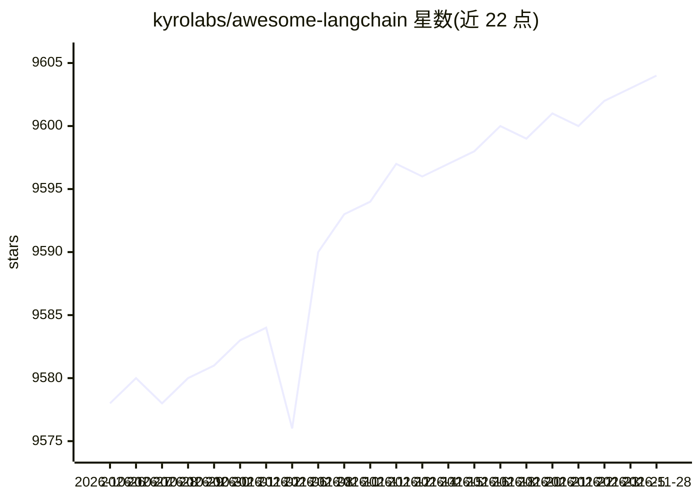

# kyrolabs/awesome-langchain

⭐ 9,604 · CC0-1.0 · 推送 2026-11-11 · [GitHub](https://github.com/kyrolabs/awesome-langchain) · 组织维护

**围绕 LangChain 框架的工具与项目策展清单**

由 kyrolabs 维护的 awesome 清单，收录使用 LangChain 框架的工具与开源项目，并按 GitHub stars 排序展示。内容按 LangChain 框架本体、多语言移植（Go/Rust/Java/Ruby 等七种）、工具（低代码、服务、Agents、模板、平台）、开源项目（知识管理、聊天机器人）等类别组织。通过 pull request 或 issue 接收社区贡献，并提供订阅 newsletter 获取更新。清单条目为链接与一句话描述，本身不提供可运行软件。

## 筛选速览

| 维度 | 判定 | 备注 |
|---|---|---|
| AI 角色 | `ai-knowledge` | 知识聚合/清单类 |
| 许可风险 | `viral` | CC0-1.0 |
| 部署形态 | `None` |  |
| 模型依赖 | — | README 未给出锁定关系 |
| 硬件要求 | — | 无带数字的原话,不猜 |
| 安装摩擦 | `low` | 无编译、无系统依赖或容器化 |
| 成熟度 | — | 结构信号不足 |

## 能力要点

- 收录使用 LangChain 的工具与项目，按 GitHub stars 展示
- 覆盖 LangChain 的七种非官方语言移植
- 类别包括低代码、服务、Agents、模板、平台、知识管理
- 通过 PR/issue 接受社区贡献并提供 newsletter 订阅

## 适用场景

- 查找基于 LangChain 构建的工具和开源项目
- 了解 LangChain 生态在各语言和场景的覆盖情况
- 为自己的 LLM 项目寻找参考实现或模板

## 场景标签

`精选清单` · 领域:学习与行业

## 证据(README 行号)

> L3: > Curated list of tools and projects using LangChain.
> L6: Here is an attempt to keep track of the initiatives around LangChain.

## 星数曲线

2026-10-26 9,578 → 2026-11-28 9,604（+26）

---
*卡片 v1 · prompt 1.4 · 生成 2026-11-22 · 置信度 high · 依据 README sha `d86b5e9b3988` · [字段定义](../../DATASET.md)*
