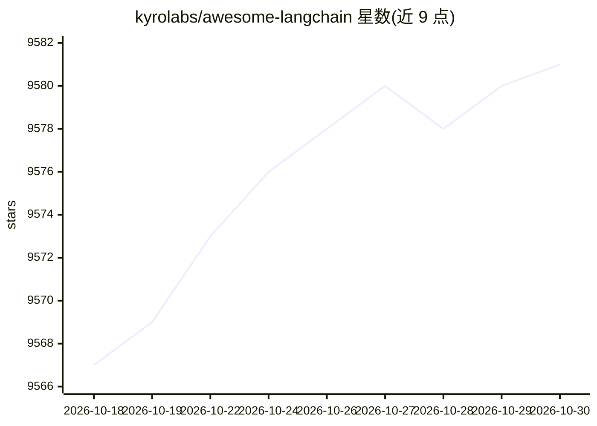

# kyrolabs/awesome-langchain

⭐ 9,581 · CC0-1.0 · 推送 2026-10-17 · [GitHub](https://github.com/kyrolabs/awesome-langchain) · 组织维护

**LangChain 生态工具与项目策展清单**

由 KyroLabs 维护的 awesome list：收录基于 LangChain 框架的工具与开源项目，按框架本体、其他语言移植（Go/Ruby/Java/Dart/Haskell/Elixir/Rust）、低代码工具、服务、Agent、模板、平台、知识管理等类别组织，条目附简介与 GitHub 星标，另配套订阅 newsletter。仅做链接策展，不提供可安装的软件本体，通过 PR 贡献新条目。

## 筛选速览

| 维度 | 判定 | 备注 |
|---|---|---|
| AI 角色 | `ai-knowledge` | 知识聚合/清单类 |
| 许可风险 | `viral` | CC0-1.0 |
| 部署形态 | `None` |  |
| 模型依赖 | — | README 未给出锁定关系 |
| 硬件要求 | — | 无带数字的原话,不猜 |
| 安装摩擦 | `low` | 无编译、无系统依赖或容器化 |
| 成熟度 | — | 结构信号不足 |

## 能力要点

- 按 10+ 类别组织 LangChain 生态条目（工具/Agent/模板/平台/开源项目）
- 收录 7 种语言的 LangChain 非官方移植
- 配套 newsletter 与贡献指南

## 适用场景

- 为 LangChain 项目选型时查找配套工具与模板
- 了解 LangChain 生态各语言移植版本
- 发现基于 LangChain 的开源 Agent 与 RAG 应用

## 场景标签

`精选清单` · 领域:学习与行业

## 证据(README 行号)

> L3: > Curated list of tools and projects using LangChain.
> L6: Here is an attempt to keep track of the initiatives around LangChain.

## 星数曲线

2026-10-18 9,567 → 2026-10-30 9,581（+14）

---
*卡片 v1 · prompt 1.4 · 生成 2026-10-20 · 置信度 high · 依据 README sha `4cce4ba9ee6c` · [字段定义](../../DATASET.md)*
