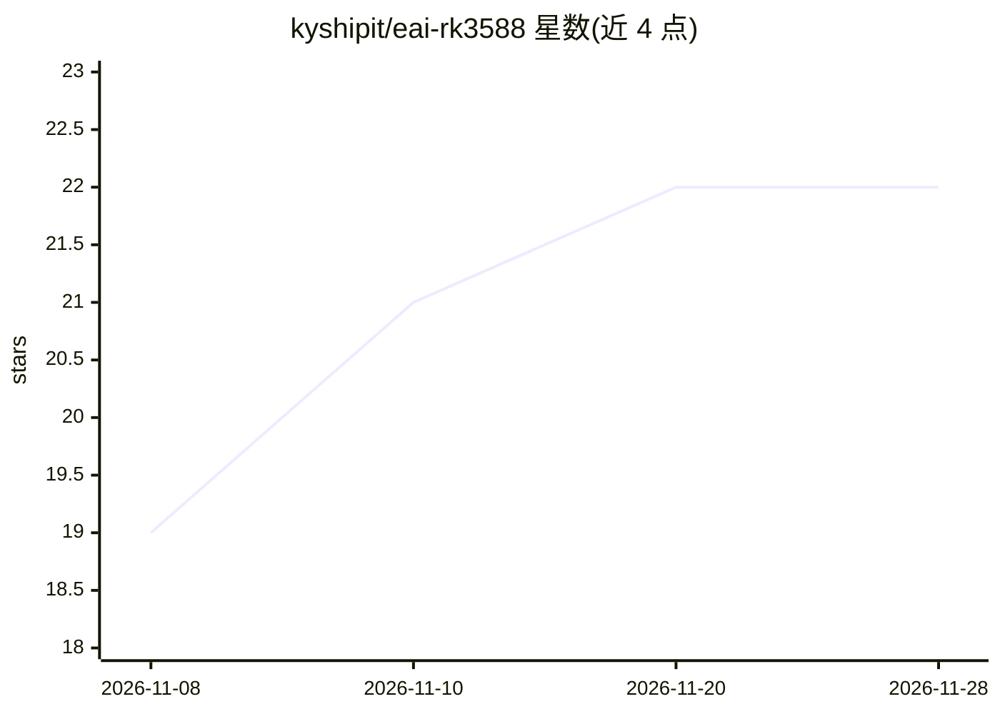

# kyshipit/eai-rk3588

⭐ 22 · C · MIT · 推送 2026-11-18 · [GitHub](https://github.com/kyshipit/eai-rk3588) · 个人维护 · 中文 README

**RK3588 边缘推理平台：视觉检测+本地对话+TTS 全流程**

面向 Rockchip RK3588/RK3588S 的插件式边缘 AI 应用平台，由单个 YAML 配置驱动，采用多线程视频管线与插件架构。内置 YOLO、SCRFD 视觉模型，RKLLM 本地对话与 MeloTTS 语音合成，默认演示人员检测→人脸识别→自动问候→语音对话的完整闭环；每帧视觉推理与 LLM/TTS 侧路径线程解耦。需交叉编译部署，依赖厂商 BSP 内核的 rknpu/MPP/RGA 驱动；在 ALIENTEK 与 Firefly LubanCat 板卡上验证过。

## 筛选速览

| 维度 | 判定 | 备注 |
|---|---|---|
| AI 角色 | `ai-native` | 本体是模型或模型工具 |
| 许可风险 | `permissive` | MIT |
| 部署形态 | `None` |  |
| 模型依赖 | — | README 未给出锁定关系 |
| 硬件要求 | — | 无带数字的原话,不猜 |
| 安装摩擦 | `low` | 无编译、无系统依赖或容器化 |
| 成熟度 | — | 结构信号不足 |

## 能力要点

- 多线程视频管线与插件架构，单 YAML 配置驱动，改配置无需重编译
- YOLO/SCRFD 视觉推理与 RKLLM 对话、MeloTTS 合成的端到端闭环
- .rkllm 缺失时自动回退为纯视觉模式
- LLM/TTS 独立侧路径线程，不阻塞每帧推理管线

## 适用场景

- 在 RK3588 板卡上搭建人员检测加语音迎宾的交互应用
- 本地运行小模型对话与语音合成而无需云端服务
- 按板卡更换摄像头节点/工具链后移植到其他 RK3588 设备

## 场景标签

`语音合成` `人脸识别` `目标检测` `聊天机器人` · 领域:对话与助手

## 证据(README 行号)

> L3: # EAI-RK3588: Plugin-Based Edge AI Platform
> L5: EAI-RK3588 is an extensible edge inference platform for Rockchip RK3588 / RK3588S. It is driven by a single YAML con

## 星数曲线

2026-11-08 19 → 2026-11-28 22（+3）

---
*卡片 v1 · prompt 1.4 · 生成 2026-11-18 · 置信度 high · 依据 README sha `308218e6cb97` · [字段定义](../../DATASET.md)*
