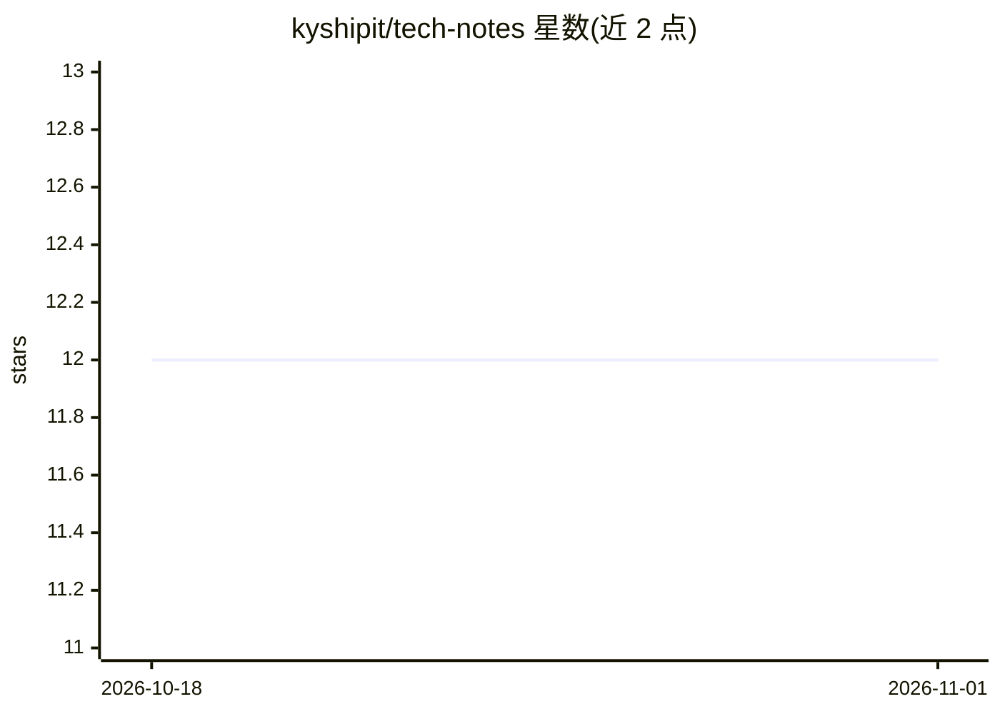

# kyshipit/tech-notes

⭐ 12 · Shell · CC-BY-SA-4.0 · 推送 2026-10-31 · [GitHub](https://github.com/kyshipit/tech-notes) · 个人维护 · 中文 README

**嵌入式/边缘AI/机器人/物联网技术笔记合集，持续更新**

由 kyshipit 维护的技术笔记文档仓库，覆盖 AI 知识体系与工程实践、RKNN/ONNX 量化部署、ROS2 仿真导航与交叉编译、RK3588 移植排障、CAN/蓝牙/NFC 等物联网协议，以及逆向工具与辅助脚本，并链接其开源项目（eai-rk3588、MeloTTS RKNN 部署、ros-robot）。笔记以 Markdown 文档形式提供，附 configure-rootfs.sh 等脚本；内容以 RK3588 边缘计算为主线。

## 筛选速览

| 维度 | 判定 | 备注 |
|---|---|---|
| AI 角色 | `ai-knowledge` | 知识聚合/清单类 |
| 许可风险 | `viral` | CC-BY-SA-4.0 |
| 部署形态 | `None` |  |
| 模型依赖 | — | README 未给出锁定关系 |
| 硬件要求 | — | 无带数字的原话,不猜 |
| 安装摩擦 | `medium` | 含编译或系统依赖之一 |
| 成熟度 | — | 结构信号不足 |

## 能力要点

- RKNN/ONNX 量化部署笔记（含 MeloTTS RK3588 量化全流程）
- ROS2 仿真导航、WSL2 通信与 RK3588 交叉编译实践
- CAN UDS/BLE/NFC 车联网与近场通信协议讲解
- 附带 rootfs 打包等辅助脚本与开源项目链接

## 适用场景

- 查找 RK3588 上模型量化与 NPU 部署的实操参考
- 解决 ROS2 交叉编译、WSL2 通信等工程问题
- 学习 CAN/UDS、BLE、NFC 等物联网协议原理

## 场景标签

`教程课程` · 领域:学习与行业

## 证据(README 行号)

> L23: > 📖 Technical notes on embedded systems, AI, robotics, IoT, and other related fields, continuously updated.
> L25: ## ✨ Content Overview

## 星数曲线

2026-10-18 12 → 2026-11-01 12（+0）

---
*卡片 v1 · prompt 1.4 · 生成 2026-11-01 · 置信度 high · 依据 README sha `347e10b66a66` · [字段定义](../../DATASET.md)*
