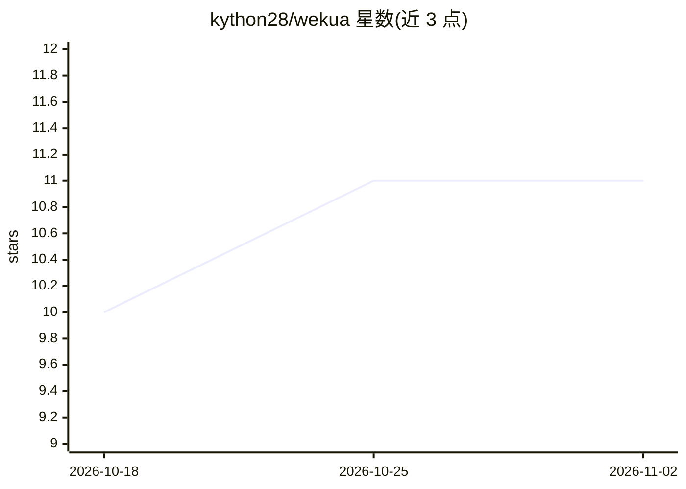

# kython28/wekua

⭐ 11 · Zig · MIT · 推送 2026-08-26 · [GitHub](https://github.com/kython28/wekua) · 个人维护

**Zig 编写的 GPGPU 线性代数与深度学习库**

基于 Zig 实现的线性代数与深度学习库，通过 OpenCL 进行 GPGPU 与异构计算，可在支持 OpenCL 的 AMD/NVIDIA/Intel GPU 或 CPU 上构建并运行深度学习模型与张量运算，并支持将机器中多颗处理芯片组合使用。安装前需先安装 OpenCL 运行时，再通过 build.zig.zon 与 build.zig 集成到 Zig 项目并用 zig build 编译。README 附 XOR 神经网络示例。项目同时存在 C 与 Zig 两个版本，Zig 版仍在开发中，C 版当前稳定但将在 Zig 版覆盖全部功能后被弃用。

## 筛选速览

| 维度 | 判定 | 备注 |
|---|---|---|
| AI 角色 | `ai-ecosystem` | LLM/agent 周边工具 |
| 许可风险 | `permissive` | MIT |
| 部署形态 | `None` |  |
| 模型依赖 | — | README 未给出锁定关系 |
| 硬件要求 | — | 无带数字的原话,不猜 |
| 安装摩擦 | `low` | 无编译、无系统依赖或容器化 |
| 成熟度 | `idea` | |

## 能力要点

- 基于 OpenCL 的 GPGPU 与异构计算
- 支持 AMD/NVIDIA/Intel GPU 与 CPU
- 可组合机器内多颗处理芯片执行模型或张量运算
- 通过 build.zig.zon 集成，提供 XOR 神经网络示例

## 适用场景

- 在 Zig 项目中构建并运行 GPU 上的深度学习模型
- 在无 NVIDIA GPU 的硬件上用 OpenCL 运行张量运算
- 利用机器内多种处理芯片做异构计算

## 场景标签

`推理引擎` · 领域:训练与推理

## 证据(README 行号)

> L3: **Wekua** is a lightweight and optimized library that allows you to build and run deep learning models using GPGPU a
> L5: Thanks to OpenCL, Wekua offers the flexibility to build and run deep learning models on any processing chip that sup

## 星数曲线

2026-10-18 10 → 2026-11-02 11（+1）

---
*卡片 v1 · prompt 1.4 · 生成 2026-11-02 · 置信度 mid · 依据 README sha `7e456e991918` · [字段定义](../../DATASET.md)*
