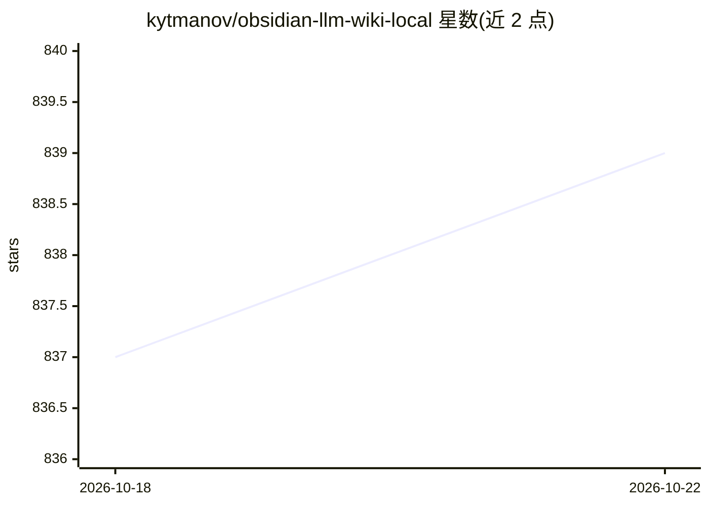

# kytmanov/obsidian-llm-wiki-local

⭐ 840 · Python · MIT · 推送 2026-05-26 · [GitHub](https://github.com/kytmanov/obsidian-llm-wiki-local) · 个人维护

**本地 LLM 驱动的 Obsidian 个人维基生成与维护工具**

实现 Karpathy 提出的 LLM Wiki 模式：用户将 Markdown 笔记放入 raw/ 目录，流水线用 LLM 抽取概念并自动创建/更新带 wikilink 的维基条目，维基存于 Obsidian 仓库中。默认用 Ollama 完全本地运行，也支持任何 OpenAI 兼容端点（Groq、Together、vLLM、Azure 等）。机制包括增量编译、文件监听、草稿驳回反馈、手工编辑保留、无向量库的 query 应答与合成页、多语言检测与 git 自动提交。README 声明进入维护模式，新功能转移到后继项目 Synto。以 pip 包提供。

## 筛选速览

| 维度 | 判定 | 备注 |
|---|---|---|
| AI 角色 | `ai-native` | 本体是模型或模型工具 |
| 许可风险 | `permissive` | MIT |
| 部署形态 | `library` | 以包/库形式分发 |
| 模型依赖 | local-ok | 支持本地模型 |
| 硬件要求 | — | 无带数字的原话,不猜 |
| 安装摩擦 | `low` | 无编译、无系统依赖或容器化 |
| 成熟度 | `idea` | |

## 能力要点

- 笔记→概念抽取→维基条目的自动编译流水线，增量更新
- 默认 Ollama 完全本地运行，也可切换任何 OpenAI 兼容端点
- 驳回反馈机制：带理由驳回草稿，下次编译纳入反馈
- olw query 无需向量库即可从已发布维基回答并生成合成页

## 适用场景

- 把零散笔记自动整理成互相链接的 Obsidian 知识库
- 完全离线地维护并查询个人维基
- 多语言笔记自动生成对应语言的维基条目

## 场景标签

`知识库管理` · 领域:知识与检索

## 证据(README 行号)

> L12: Drop a markdown file into a folder. The pipeline reads it, extracts concepts, and creates or updates wiki articles.
> L14: **Local-first, provider-flexible.** Runs 100% locally with Ollama by default. Also works with any OpenAI-compatible
> L36: You write raw notes  →  LLM extracts concepts  →  Wiki articles created/updated

## 星数曲线

2026-10-18 837 → 2026-10-22 839（+2）

---
*卡片 v1 · prompt 1.4 · 生成 2026-10-21 · 置信度 high · 依据 README sha `6a46763423db` · [字段定义](../../DATASET.md)*
